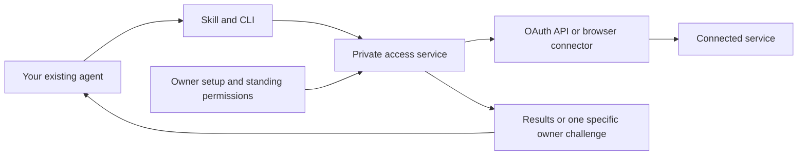

# Account Access

[](https://github.com/fainir/account-access/actions/workflows/check.yml)
[](LICENSE)

**Connect once. Grant specific permissions. Let your existing AI agent do the routine work.**

Account Access is a local authentication and delegated-access service for **Codex, Claude Code and other agents**. A portable skill and CLI let an agent request approved operations while the service manages credentials, sessions, renewal and resumable tasks. There is **no MCP dependency**.

**Status: release candidate.** The demo is usable today. Real websites require reviewed connectors; this is not an “add any website” consumer app or validated production access to banks, Google, Meta or insurance accounts.

## Easy installation

On a Mac, [download the installer](https://github.com/fainir/account-access/releases/download/v0.4.1/Account-Access-Installer.zip), unzip it, and open **Install Account Access.command**.

The installer prepares Python, Account Access and its browser automatically, then opens a guided setup page. You do not need Git, a Python installation, a JSON configuration, or a terminal left running.

If macOS blocks the unsigned launcher, use this alternative: open Terminal, paste this one line, and press Enter.

```sh
curl -fsSL https://raw.githubusercontent.com/fainir/account-access/v0.4.1/install.sh | sh
```

No administrator rights are needed on macOS. Linux may need [browser system libraries and sandbox configuration](docs/setup.md#linux-sandbox-setup). Native Windows support is not implemented.

A [native graphical Mac preview](macos/README.md) also installs the app, adds the AI skills, and connects supported accounts without a terminal window. Its Developer ID signature verifies; Apple notarization is pending because the configured Xcode account could not authenticate. Gatekeeper can block the preview download. The new recording uses this genuine graphical build.

## Connect and use

1. Choose **Codex**, **Claude Code**, or both, and click **Set up my AI tools**. Have the selected AI tool installed and signed in already.
2. Select a supported account, enter its username/password, check the permitted reads, and click **Connect account**.
3. Repeat for other accounts. The included catalog provides a personal shopping account, work shopping account, and membership account using public example websites.
4. Copy the request shown in setup into a fresh Codex chat or Claude Code session.

For example:

> Use $account-access to read one permitted operation from each connected account. Give me a short summary of each. Save progress as a task.

In Claude Code, start the request with `/account-access` instead.

Account Access saves accepted sessions and reuses them across requests. You can close the setup page and installer terminal; the local service continues running. Your computer must stay awake. After a restart, open **Account Access.command** in your user Applications folder to resume.

The built-in connections use SauceDemo's public shopping logins (`standard_user` / `secret_sauce`, or `problem_user` / `secret_sauce`) and The Internet's public membership login (`tomsmith` / `SuperSecretPassword!`). They let you try the full connection flow without a private account. Other services need reviewed connectors; setup does not automatically add support for any website.

Use **Manage permissions** to reconnect or revoke access. **Stop Account Access** stops the local app while keeping saved connections.

## Screen recording

[Watch Account Access in the actual Claude Code app](https://github.com/fainir/account-access/releases/download/v0.4.0/account-access-claude-code-live.mp4). This narrated screen recording shows one request reading three connected example accounts and returning a product comparison and membership welcome message. It includes captions.

The video starts with accounts already connected. Follow [Easy installation](#easy-installation) and [Connect and use](#connect-and-use) above to set up your computer. Installation and browser setup footage, and a recording of the Codex interface, are still pending. Both agents have completed the same live three-account test; see the [recording and verification notes](docs/video/README.md).

The [previous edited overview](docs/video/legacy-guide.md) covers the older manual setup.

<details>
<summary>Developer installation and local test accounts</summary>

```sh
git clone https://github.com/fainir/account-access.git
cd account-access
uv sync --locked --python 3.13
uv run playwright install chromium
uv build
uv tool install --python 3.13 --force ./dist/account_access-0.4.1-py3-none-any.whl
account-access start
```

For a controlled development fixture with OAuth/password/TOTP accounts:

```sh
account-access --root "$HOME/.local/share/account-access-demo" demo --install
```

Keep that development-demo terminal open. These accounts contain synthetic balances and use a development key; keep this directory separate from real accounts. Append `--public-sites` to include published public website identities.

</details>

## How it works



The owner connects an account and grants named operations once. The agent can discover and execute those operations; it cannot choose arbitrary URLs, export credentials or grant itself more access through the service API.

The service reuses accepted browser sessions, refreshes eligible OAuth access and can perform configured password/TOTP recovery. If a provider requires genuine device, passkey, biometric or administrator approval, the task pauses with a specific challenge. Repairing access resumes checkpointed service steps. It does not automatically restart an entire terminated AI conversation.

## What works today

| Capability | Status |
| --- | --- |
| Codex and Claude Code | Portable skill tested through Codex CLI and the actual Claude Code desktop interface; both completed three-account live reads |
| Other agents | Same skill in a supported directory, or the CLI/authenticated API; other named hosts have not been executed |
| OAuth code + PKCE and renewal | Controlled failure tests and external Duende demo refresh-token rotation |
| Website email/username + password | Reviewed forms, encrypted sessions and bounded recovery; controlled sites and public demos tested |
| Authenticator TOTP | Explicitly enrolled login-only seeds; controlled end-to-end test |
| Email/SMS login codes | Gmail/Twilio adapters with contract tests; live delivery not validated |
| Passkey, fingerprint, device or admin approval | Genuine owner handoff; provider-required presence remains a human step |
| Existing Chrome session | Experimental extension/native bridge; unit-tested, not live Chrome validated; no password-vault extraction |
| iPhone/Android SMS inboxes | No native companion or universal inbox capture shipped |
| Payments, filings and account-changing writes | Unsupported; configured reads only |

macOS has been exercised locally. Linux is covered by the repository's CI workflow. Native Windows service transport is not implemented. A cloud agent needs a reachable HTTPS broker; installing a local skill does not expose your laptop's localhost to the cloud.

## Real accounts and owner setup

Real accounts require a **reviewed connector** with fixed operations, destinations and authentication markers. There is no automatic connector for an arbitrary website. The [Google Drive example](examples/google-drive.json) illustrates the API configuration; it needs a registered OAuth app and has not been validated on a private Google account.

Once that configuration exists, the owner initializes the vault, installs the agent clients, opens the local setup console, connects the account and selects permissions. Passwords and codes belong in that local flow, never in chat or GitHub issues.

See [real-account setup, other agents and Chrome instructions](docs/setup.md). For a distributed product, the operator should provide the approved OAuth applications instead of asking every end user to register one.

<details>
<summary>Preview the owner console (synthetic accounts)</summary>


</details>

## Durable tasks

For work that needs to survive an authentication interruption:

```sh
python3 "$HOME/.agents/skills/account-access/scripts/access.py" task submit \
  --key first-account-check \
  --steps 'demo-api:summary,demo-web:summary,demo-mfa:summary'
```

Copy the returned task ID, then:

```sh
python3 "$HOME/.agents/skills/account-access/scripts/access.py" task wait TASK_ID --timeout 60
python3 "$HOME/.agents/skills/account-access/scripts/access.py" task get TASK_ID
```

The worker preserves completed steps, retries temporary failures with backoff, and shares one unresolved authentication challenge across blocked tasks. Reusing the same key and steps returns the existing task. A new run needs a new key. Tasks and schedules require the service to be running and the computer awake; push notification delivery is not implemented.

## Troubleshooting

| Symptom | What to do |
| --- | --- |
| `account-access: command not found` | Run `uv tool update-shell`, then open a new terminal. |
| `service_unavailable` | Start the demo/service and keep its terminal open; use the script for the installation you intend to reach. |
| Agent cannot find the skill | Start a fresh chat/session. The installer uses `~/.agents/skills/account-access` for Codex and `~/.claude/skills/account-access` for Claude. |
| Chromium is missing or cannot launch | Run `uv run playwright install chromium` in this checkout; on Linux also install its system dependencies. |
| Ubuntu browser still cannot launch | Have the administrator review the [per-binary AppArmor setup](docs/setup.md#linux-sandbox-setup). |
| `existing_skill_would_be_overwritten` | An unrelated directory already has that name. Review it or choose a custom supported skills directory; the installer does not overwrite unknown skills. |
| `NEEDS_USER` | Complete the specified step in owner setup. Preserve the same task ID. |
| `DENIED` | Review the owner grant/configuration. The agent should not try another login path to bypass it. |
| Keyring unavailable/locked | Configure or unlock the supported OS keyring. File-key mode is for development demos, not production credentials. |

## Validation and development

Recorded on 12 October 2026:

- **43 regression tests passed.**
- **90/90 controlled repeated reads** completed unattended after programmatic demo enrollment.
- **25/25 external public-demo reads** completed across SauceDemo, The Internet and Duende, including ten rotating OAuth refreshes.
- **Codex and Claude Code each completed a five-account task**, independently verified through the service.

These accelerated results do not establish thirty-day reliability or private financial-account coverage. See the [full validation report](docs/validation.md) and [machine-readable evidence](artifacts/).

For public distribution on 13 October 2026, a clean-checkout installation completed the three-account demo, and [Linux CI passed all 43 tests, lint, dependency auditing and package building](https://github.com/fainir/account-access/actions/runs/38374863318). See [publication verification](artifacts/public-release.json).

```sh
uv run ruff check account_access tests scripts
uv run pytest -q
uv run pip-audit --local
uv run python scripts/benchmark.py
# Optional external network experiment with published demo identities only:
uv run python scripts/public_demos.py --runs 5
uv build
```

See [CONTRIBUTING.md](CONTRIBUTING.md) to add reviewed connectors and tests.

## Security and documentation

Credentials, sessions and task outputs are encrypted. Agent clients receive scoped identities, and every operation/result access rechecks standing permissions. Website content is untrusted. These controls do not isolate secrets from an agent with unrestricted shell access under the same OS user: strong credential custody requires a separate OS identity or host.

- [Architecture and trust boundaries](docs/architecture.md)
- [Research and design choices](docs/research.md)
- [Setup and advanced usage](docs/setup.md)
- [Validation and remaining production work](docs/validation.md)
- [Security reporting policy](SECURITY.md)
- [TLS deployment example](deployment/nginx.conf.example)

## License

[MIT](LICENSE). Dependencies retain their own licenses.

## Guided setup validation (0.4.0)

On 13 October 2026, **50 distinct tests passed**: a 49-test regression run followed by 11 focused installation checks, including one added symlink-preservation case. The guided setup checks cover authenticated/CSRF-protected account connection, both agents' standing grants, shared session reuse, refusing unreviewed destinations, a launcher that needs no Python on PATH, and reopening/stopping the background app. The installer rejects modified downloads before executing them, and local app startup rejects an impostor on a reused port. Dependency auditing found no known vulnerabilities in the third-party packages. A live screen recording of the guided interface is still pending.
