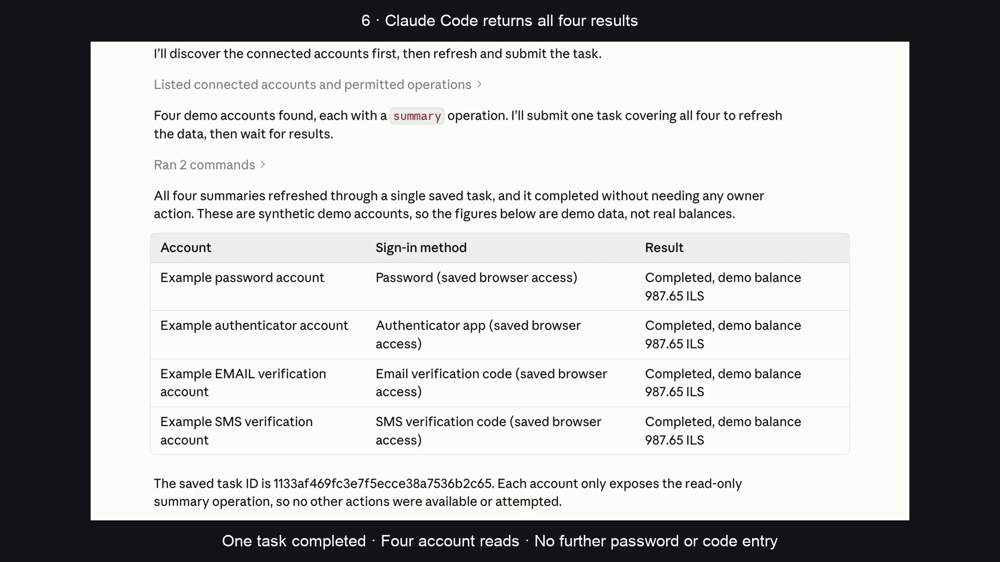
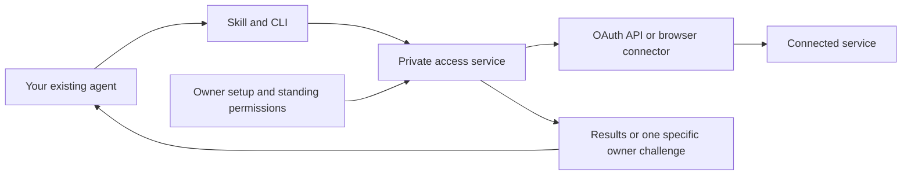

# Account Access

[](https://github.com/fainir/account-access/actions/workflows/check.yml)
[](LICENSE)

**Connect once. Grant specific permissions. Let your existing AI agent do the routine work.**

Account Access is a local authentication and delegated-access service for **Codex, Claude Code and other agents**. A portable skill and CLI let an agent request approved operations while the service manages credentials, sessions, renewal and resumable tasks. There is **no MCP dependency**.

**Status: 0.6 preview.** The included examples are usable today. Real websites require reviewed connectors; this is not an “add any website” consumer app or validated production access to banks, Google, Meta or insurance accounts.


## Easy installation

On a Mac, [download Account Access 0.6](https://github.com/fainir/account-access/releases/download/v0.6.0/Account-Access-Mac-preview.zip), unzip it, open **Account Access**, and click **Install Account Access**. The app prepares Python, the browser and the local service. No developer tools, terminal commands or administrator password are needed for this flow.

This is a **Developer ID signed preview**. Apple notarization is still pending, so Gatekeeper may block a fresh download. The recording verifies installation on our Mac, not a completed notarized distribution. See [Mac build and distribution notes](macos/README.md).

Have your AI tool installed and signed in. Account Access automatically installs one portable skill and CLI, with discovery folders for detected Codex and Claude Code installations. There is no agent-selection step. Other local agents can use the same CLI or load the skill from their supported folder.

Linux developers can use the [setup guide](docs/setup.md); browser libraries and sandbox configuration may require an administrator. Native Windows support is not implemented.

## Connect and use

1. Click **Import saved passwords**, select an export from your password manager, review matching supported accounts, and approve the reads you want your AI to perform. You can also enter one account's login locally.
2. Open **Verification** and connect the required email, SMS or authenticator source once.
3. When your accounts show **Connected**, open your AI tool and ask for the work in ordinary language.

For example:

> Find the cheapest item in my personal and work shopping accounts, and show my membership welcome message.

**No slash command or skill prefix is required.** New Codex and Claude Code sessions load the Account Access integration automatically. The agent discovers permitted operations and uses the saved account access when relevant. First-time installation requires a fresh session; existing conversations may already have cached their instructions. [Automatic session setup](docs/automatic-sessions.md) describes the supported hosts and limits.

The local service starts on demand when the installed client needs it. It reuses saved sessions and handles configured login challenges. If you deliberately pause it, open Account Access to resume. Genuine device, passkey, biometric or administrator approval remains a specific owner action.

The built-in catalog contains public SauceDemo shopping accounts and The Internet's public membership account. **Importing a password does not create a connector for an unsupported website.** An operator must supply a reviewed connector before private services can be connected. The four-factor recording uses separately configured, controlled example accounts.

### Passwords from Chrome and other managers

Export passwords as CSV, then choose that file in **Import saved passwords**. Supported layouts include Chrome, Apple Passwords, compatible 1Password CSV and Bitwarden login exports. [Google's export instructions](https://support.google.com/chrome/answer/13068232) and [Apple's export instructions](https://support.apple.com/guide/passwords/mchl35b12625/mac) describe their export flows.

The app shows matching account names and usernames, hides passwords, and saves only approved selections in the encrypted vault. Unsupported entries are not retained. A compatible authenticator seed or `otpauth://` URI can be imported **only when you explicitly enable authenticator import**. Passkeys and proprietary encrypted exports are not imported.

A CSV export contains plaintext passwords. The app can move that export to Trash after importing; it does not securely erase the file or empty Trash. Never send an export in chat or commit it to a repository. Account Access does not extract Chrome's encrypted password database silently.

### Email, SMS and authenticator codes

| Method | One-time setup | During a supported login |
| --- | --- | --- |
| Email | Connect a configured TLS IMAP mailbox, or a reviewed Gmail OAuth connection | Read a fresh message matching sender, recipient, subject and template; submit its login code |
| iPhone SMS on Mac | Enable text forwarding to Messages, then grant the signed Account Access app Full Disk Access | Read incoming fresh Messages entries matching the configured sender and template |
| Android SMS | Pair the [phone preview](android/README.md), allow notification access and use the same private Wi-Fi | Forward a matching SMS-app notification to the certificate-pinned HTTPS login endpoint |
| Authenticator TOTP | Explicitly enroll a supported setup QR/key, or opt into a compatible seed import | Generate and submit the six-digit login code locally |

Email support depends on the provider exposing IMAP or the configured Gmail OAuth API; there is no universal webmail scraper. Gmail and other providers may require an app password or approved OAuth application. Existing authenticator codes cannot be recovered from every app: standard six-digit SHA-1 TOTP with a 30-second period is supported; push approval is an owner step.

Mac Full Disk Access and Android notification access are broader OS permissions than the app's own sender/template filters. The service consumes codes only within an active login window and rejects stale, duplicated or ambiguous messages. Passwords, cookies and codes are not returned through the agent API. Code sources can be disabled in owner setup.

Close the setup app when finished; your AI can start the saved local service when needed, including after a restart. Your computer must be awake and its secure keyring available. Use **Manage accounts and verification** to reconnect or revoke access.

## Screen recording from version 0.5

[Watch installation, password import and automatic verification in Claude Code](https://github.com/fainir/account-access/releases/download/v0.5.0/account-access-install-import-and-verify.mp4).

[](https://github.com/fainir/account-access/releases/download/v0.5.0/account-access-install-import-and-verify.mp4)

The video records the previous native installer, owner setup, actual Claude Code session and real browser form submissions. Version 0.6 has the redesigned dashboard and automatic plain-language invocation; the older video shows commands that are now optional. Four configured example accounts exercise password, authenticator, email and SMS sign-in. Email uses a real local TLS IMAP server with synthetic delivery; the recorded SMS source is a Messages-format fixture. It does not claim delivery from a real carrier, Gmail mailbox or physical phone. [Captions and recording evidence](docs/video/README.md) explain the edit and limits.

<details>
<summary>Developer installation and local test accounts</summary>

```sh
git clone https://github.com/fainir/account-access.git
cd account-access
uv sync --locked --python 3.13
uv run playwright install chromium
uv build
uv tool install --python 3.13 --force ./dist/account_access-0.6.0-py3-none-any.whl
account-access start
```

For a controlled development fixture with OAuth/password/TOTP accounts:

```sh
account-access --root "$HOME/.local/share/account-access-demo" demo --install
```

Keep that development-demo terminal open. These accounts contain synthetic balances and use a development key; keep this directory separate from real accounts. Append `--public-sites` to include published public website identities.

</details>

## How it works



The owner connects an account and grants named operations once. The agent can discover and execute those operations; it cannot choose arbitrary URLs, export credentials or grant itself more access through the service API.

The service reuses accepted browser sessions, refreshes eligible OAuth access and can perform configured password/TOTP recovery. If a provider requires genuine device, passkey, biometric or administrator approval, the task pauses with a specific challenge. Repairing access resumes checkpointed service steps. It does not automatically restart an entire terminated AI conversation.

## What works today

| Capability | Status |
| --- | --- |
| Portable skill + CLI | One shared client identity installed automatically; Codex and Claude Code exercised |
| Password imports | Reviewed CSV selections from supported layouts; optional explicit TOTP import |
| Website username/email + password | Fixed reviewed forms, encrypted sessions and bounded recovery; public and controlled examples tested |
| Authenticator TOTP | Owner enrollment, setup QR/key and controlled end-to-end login |
| Email login codes | TLS IMAP end-to-end fixture; Gmail adapter contract tests; public mailbox delivery not validated |
| iPhone SMS on Mac | Signed narrow Messages helper tested against fixtures; physical text-forwarding delivery not validated |
| Android login notifications | Actual emulator notification → Keystore pairing → pinned HTTPS → browser code submission [passed CI](https://github.com/fainir/account-access/actions/runs/38543728385); physical phones not validated |
| OAuth code + PKCE and renewal | Controlled failure tests and external Duende demo refresh-token rotation |
| Passkey, fingerprint, device or admin approval | Genuine owner handoff |
| Existing Chrome session | Experimental extension/native bridge; unit-tested, not live Chrome validated |
| Payments, filings and account-changing writes | Unsupported; configured reads only |

macOS has been exercised locally. Linux is covered by the repository's CI workflow. Native Windows service transport is not implemented. A cloud agent needs a reachable HTTPS broker; installing a local skill does not expose your laptop's localhost to the cloud.

## Real accounts and owner setup

Real accounts require a **reviewed connector** with fixed operations, destinations and authentication markers. There is no automatic connector for an arbitrary website. The [Google Drive example](examples/google-drive.json) illustrates the API configuration; it needs a registered OAuth app and has not been validated on a private Google account.

Once that configuration exists, the owner initializes the vault, installs the agent clients, opens the local setup console, connects the account and selects permissions. Passwords and codes belong in that local flow, never in chat or GitHub issues.

See [real-account setup, other agents and Chrome instructions](docs/setup.md). For a distributed product, the operator should provide the approved OAuth applications instead of asking every end user to register one.

<details>
<summary>Preview the owner console (synthetic accounts)</summary>


</details>

## Durable tasks

For work that needs to survive an authentication interruption:

```sh
python3 "$HOME/.agents/skills/account-access/scripts/access.py" task submit \
  --key first-account-check \
  --steps 'demo-api:summary,demo-web:summary,demo-mfa:summary'
```

Copy the returned task ID, then:

```sh
python3 "$HOME/.agents/skills/account-access/scripts/access.py" task wait TASK_ID --timeout 60
python3 "$HOME/.agents/skills/account-access/scripts/access.py" task get TASK_ID
```

The worker preserves completed steps, retries temporary failures with backoff, and shares one unresolved authentication challenge across blocked tasks. Reusing the same key and steps returns the existing task. A new run needs a new key. Tasks and schedules require the service to be running and the computer awake; push notification delivery is not implemented.

## Troubleshooting

| Symptom | What to do |
| --- | --- |
| `account-access: command not found` | Run `uv tool update-shell`, then open a new terminal. |
| `service_unavailable` | Reopen Account Access, or start the configured service; use the skill for the intended installation. |
| Agent cannot find the skill | Start a fresh chat/session. The installer uses `~/.agents/skills/account-access` for Codex and `~/.claude/skills/account-access` for Claude. |
| Chromium is missing or cannot launch | Run `uv run playwright install chromium` in this checkout; on Linux also install its system dependencies. |
| Ubuntu browser still cannot launch | Have the administrator review the [per-binary AppArmor setup](docs/setup.md#linux-sandbox-setup). |
| `existing_skill_would_be_overwritten` | An unrelated directory already has that name. Review it or choose a custom supported skills directory; the installer does not overwrite unknown skills. |
| `NEEDS_USER` | Complete the specified step in owner setup. Preserve the same task ID. |
| `DENIED` | Review the owner grant/configuration. The agent should not try another login path to bypass it. |
| Keyring unavailable/locked | Configure or unlock the supported OS keyring. File-key mode is for development demos, not production credentials. |

## Validation and development

Version 0.6 validation on 14 October 2026: **75 Python tests passed** locally, with lint, dependency auditing and package building also covered by the [Linux CI workflow](https://github.com/fainir/account-access/actions/workflows/check.yml). Fresh ordinary-language requests activated the integration automatically: Codex completed a saved three-account task, and Claude Code completed the three approved reads and saved a comparison file. See [Codex evidence](artifacts/agent-tests/codex-implicit-06.json), [Claude evidence](artifacts/agent-tests/claude-implicit-06.json) and [automatic startup evidence](artifacts/automatic-start-06.json). The Codex test used an account-compatible model for that invocation; Claude's unrelated session-log hook encountered four permission denials after the account work succeeded. General host policies and hooks were retained. The [Android emulator journey](https://github.com/fainir/account-access/actions/runs/38543728385) passed separately. See [four-factor recording evidence](artifacts/video/install-import-and-verify.json).

Earlier experiments on 12 October 2026:

- **43 regression tests passed.**
- **90/90 controlled repeated reads** completed unattended after programmatic demo enrollment.
- **25/25 external public-demo reads** completed across SauceDemo, The Internet and Duende, including ten rotating OAuth refreshes.
- **Codex and Claude Code each completed a five-account task**, independently verified through the service.

These accelerated results do not establish thirty-day reliability or private financial-account coverage. See the [full validation report](docs/validation.md) and [machine-readable evidence](artifacts/).

For public distribution on 13 October 2026, a clean-checkout installation completed the three-account demo, and [Linux CI passed all 43 tests, lint, dependency auditing and package building](https://github.com/fainir/account-access/actions/runs/38374863318). See [publication verification](artifacts/public-release.json).

```sh
uv run ruff check account_access tests scripts
uv run pytest -q
uv run pip-audit --local
uv run python scripts/benchmark.py
# Optional external network experiment with published demo identities only:
uv run python scripts/public_demos.py --runs 5
uv build
```

See [CONTRIBUTING.md](CONTRIBUTING.md) to add reviewed connectors and tests.

## Security and documentation

Credentials, sessions and task outputs are encrypted. Agent clients receive scoped identities, and every operation/result access rechecks standing permissions. Website content is untrusted. These controls do not isolate secrets from an agent with unrestricted shell access under the same OS user: strong credential custody requires a separate OS identity or host.

- [Architecture and trust boundaries](docs/architecture.md)
- [Research and design choices](docs/research.md)
- [Setup and advanced usage](docs/setup.md)
- [Validation and remaining production work](docs/validation.md)
- [Security reporting policy](SECURITY.md)
- [TLS deployment example](deployment/nginx.conf.example)

## License

[MIT](LICENSE). Dependencies retain their own licenses.

## Guided setup validation (0.4.0)

On 13 October 2026, **50 distinct tests passed**: a 49-test regression run followed by 11 focused installation checks, including one added symlink-preservation case. The guided setup checks cover authenticated/CSRF-protected account connection, both agents' standing grants, shared session reuse, refusing unreviewed destinations, a launcher that needs no Python on PATH, and reopening/stopping the background app. The installer rejects modified downloads before executing them, and local app startup rejects an impostor on a reused port. Dependency auditing found no known vulnerabilities in the third-party packages. A live screen recording of the guided interface is still pending.
