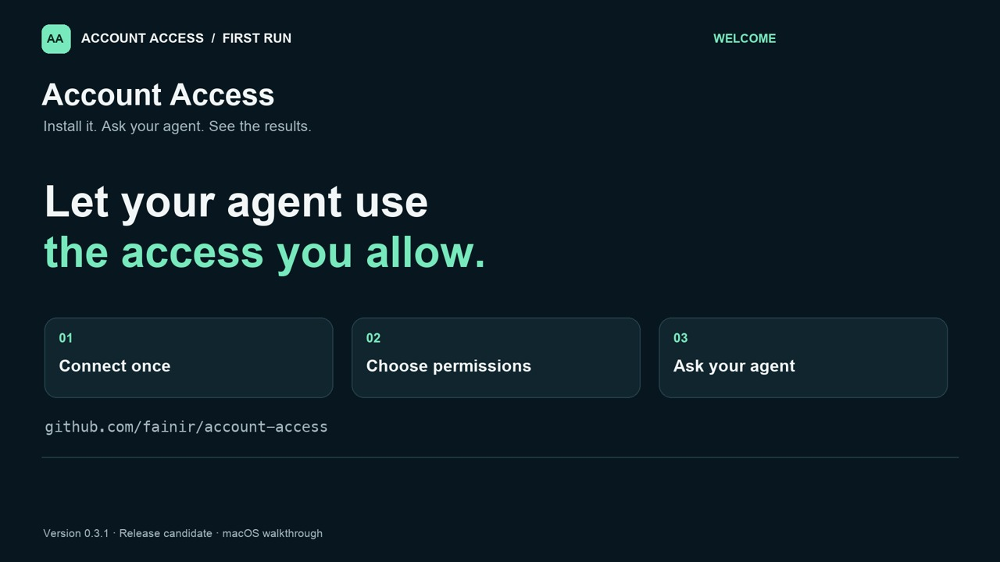
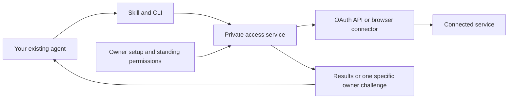

# Account Access

[](https://github.com/fainir/account-access/actions/workflows/check.yml)
[](LICENSE)

**Connect once. Grant specific permissions. Let your existing AI agent do the routine work.**

Account Access is a local authentication and delegated-access service for **Codex, Claude Code and other agents**. A portable skill and CLI let an agent request approved operations while the service manages credentials, sessions, renewal and resumable tasks. There is **no MCP dependency**.

**Status: release candidate.** The demo is usable today. Real websites require reviewed connectors; this is not an “add any website” consumer app or validated production access to banks, Google, Meta or insurance accounts.

## Watch the beginner walkthrough

[](https://github.com/fainir/account-access/releases/download/v0.3.1/account-access-walkthrough.mp4)

[Watch or download the narrated video](https://github.com/fainir/account-access/releases/download/v0.3.1/account-access-walkthrough.mp4) · [Copy the commands and read the transcript](docs/video/README.md) · [English captions](https://github.com/fainir/account-access/releases/download/v0.3.1/account-access-walkthrough.en.srt)

The **3:09 walkthrough** has English narration and captions at 1080p. It shows installation, demo startup, prompts for Codex and Claude Code, verified demo results, and the actual owner console. It uses synthetic accounts and explains the current password/SMS/email limitations.

## Quick start

You need **Git**, [**uv**](https://docs.astral.sh/uv/getting-started/installation/) and macOS or Linux. uv can install Python for you. Install Codex or Claude Code separately if you want to use an agent; you can also try the client directly.

### 1. Install

```sh
git clone https://github.com/fainir/account-access.git
cd account-access
uv sync --locked --python 3.13
uv run playwright install chromium
uv build
uv tool install --python 3.13 --force ./dist/account_access-0.3.1-py3-none-any.whl
```

On Linux, Chromium may need system libraries: run `uv run playwright install --with-deps chromium` instead of the browser-install command above. That command may request administrator access to install OS packages.

Ubuntu 23.10 and later may also require an AppArmor profile for the bundled browser's sandbox namespaces. Follow the [Linux sandbox setup](docs/setup.md#linux-sandbox-setup) if browser launch fails after dependencies are installed.

If `account-access` is not found afterward, run `uv tool update-shell` and open a new terminal. No AI API key or personal account credentials are needed for the demo.

The agent launcher also needs `python3` on its PATH. If that command is missing, run `uv python install 3.13 --default`, then `uv tool update-shell` and open a new terminal.

### 2. Start the demo

```sh
account-access --root "$HOME/.local/share/account-access-demo" demo --install
```

**Keep this terminal open.** The command starts a private local service, prepares three fictional accounts and installs the skill for Codex and Claude Code. Unrelated skills are preserved. Re-running it refreshes the demo connection and its client identities.

| Demo account | What it exercises | Expected result |
| --- | --- | --- |
| `demo-api` | OAuth, PKCE and renewable access | 1,234.56 ILS |
| `demo-web` | Password login and saved browser session | 987.65 ILS |
| `demo-mfa` | Password + enrolled login-only TOTP | 987.65 ILS |

These are **synthetic balances**, not real financial information. The demo uses a development vault key and a separate data directory. Never use the demo command with a real account's storage directory.

To also try two intentionally public testing websites, stop the demo with Ctrl+C and start it with:

```sh
account-access --root "$HOME/.local/share/account-access-demo" demo --install --public-sites
```

That adds SauceDemo inventory and The Internet's secure-area demo. It uses their published test identities, not your browser profile or personal accounts. These external sites can change or be unavailable.

### 3. Ask your agent

**Codex** — open a fresh chat and send:

> Use $account-access to read one permitted operation from every connected demo account. Save progress as a task and label the results as demo data.

**Claude Code** — start a fresh session and send:

> /account-access Read one permitted operation from every connected demo account, save progress as a task, and label the results as demo data.

The agent discovers available operations, submits work, waits for the results and reports them. You should not need to type the demo passwords or verification codes.

**Try it without an agent** — in a second terminal:

```sh
python3 "$HOME/.agents/skills/account-access/scripts/access.py" doctor
python3 "$HOME/.agents/skills/account-access/scripts/access.py" accounts
python3 "$HOME/.agents/skills/account-access/scripts/access.py" run demo-api summary
```

`doctor` should return `"status": "OK"` and `"service_reachable": true`. `run` should return `"status": "COMPLETED"` with demo data. The client script selects the installed package's interpreter; `python3` only launches that small script.

## How it works



The owner connects an account and grants named operations once. The agent can discover and execute those operations; it cannot choose arbitrary URLs, export credentials or grant itself more access through the service API.

The service reuses accepted browser sessions, refreshes eligible OAuth access and can perform configured password/TOTP recovery. If a provider requires genuine device, passkey, biometric or administrator approval, the task pauses with a specific challenge. Repairing access resumes checkpointed service steps. It does not automatically restart an entire terminated AI conversation.

## What works today

| Capability | Status |
| --- | --- |
| Codex and Claude Code | Portable skill installed and tested through both actual CLI agents |
| Other agents | Same skill in a supported directory, or the CLI/authenticated API; other named hosts have not been executed |
| OAuth code + PKCE and renewal | Controlled failure tests and external Duende demo refresh-token rotation |
| Website email/username + password | Reviewed forms, encrypted sessions and bounded recovery; controlled sites and public demos tested |
| Authenticator TOTP | Explicitly enrolled login-only seeds; controlled end-to-end test |
| Email/SMS login codes | Gmail/Twilio adapters with contract tests; live delivery not validated |
| Passkey, fingerprint, device or admin approval | Genuine owner handoff; provider-required presence remains a human step |
| Existing Chrome session | Experimental extension/native bridge; unit-tested, not live Chrome validated; no password-vault extraction |
| iPhone/Android SMS inboxes | No native companion or universal inbox capture shipped |
| Payments, filings and account-changing writes | Unsupported; configured reads only |

macOS has been exercised locally. Linux is covered by the repository's CI workflow. Native Windows service transport is not implemented. A cloud agent needs a reachable HTTPS broker; installing a local skill does not expose your laptop's localhost to the cloud.

## Real accounts and owner setup

Real accounts require a **reviewed connector** with fixed operations, destinations and authentication markers. There is no automatic connector for an arbitrary website. The [Google Drive example](examples/google-drive.json) illustrates the API configuration; it needs a registered OAuth app and has not been validated on a private Google account.

Once that configuration exists, the owner initializes the vault, installs the agent clients, opens the local setup console, connects the account and selects permissions. Passwords and codes belong in that local flow, never in chat or GitHub issues.

See [real-account setup, other agents and Chrome instructions](docs/setup.md). For a distributed product, the operator should provide the approved OAuth applications instead of asking every end user to register one.

<details>
<summary>Preview the owner console (synthetic accounts)</summary>


</details>

## Durable tasks

For work that needs to survive an authentication interruption:

```sh
python3 "$HOME/.agents/skills/account-access/scripts/access.py" task submit \
  --key first-account-check \
  --steps 'demo-api:summary,demo-web:summary,demo-mfa:summary'
```

Copy the returned task ID, then:

```sh
python3 "$HOME/.agents/skills/account-access/scripts/access.py" task wait TASK_ID --timeout 60
python3 "$HOME/.agents/skills/account-access/scripts/access.py" task get TASK_ID
```

The worker preserves completed steps, retries temporary failures with backoff, and shares one unresolved authentication challenge across blocked tasks. Reusing the same key and steps returns the existing task. A new run needs a new key. Tasks and schedules require the service to be running and the computer awake; push notification delivery is not implemented.

## Troubleshooting

| Symptom | What to do |
| --- | --- |
| `account-access: command not found` | Run `uv tool update-shell`, then open a new terminal. |
| `service_unavailable` | Start the demo/service and keep its terminal open; use the script for the installation you intend to reach. |
| Agent cannot find the skill | Start a fresh chat/session. The installer uses `~/.agents/skills/account-access` for Codex and `~/.claude/skills/account-access` for Claude. |
| Chromium is missing or cannot launch | Run `uv run playwright install chromium` in this checkout; on Linux also install its system dependencies. |
| Ubuntu browser still cannot launch | Have the administrator review the [per-binary AppArmor setup](docs/setup.md#linux-sandbox-setup). |
| `existing_skill_would_be_overwritten` | An unrelated directory already has that name. Review it or choose a custom supported skills directory; the installer does not overwrite unknown skills. |
| `NEEDS_USER` | Complete the specified step in owner setup. Preserve the same task ID. |
| `DENIED` | Review the owner grant/configuration. The agent should not try another login path to bypass it. |
| Keyring unavailable/locked | Configure or unlock the supported OS keyring. File-key mode is for development demos, not production credentials. |

## Validation and development

Recorded on 12 October 2026:

- **43 regression tests passed.**
- **90/90 controlled repeated reads** completed unattended after programmatic demo enrollment.
- **25/25 external public-demo reads** completed across SauceDemo, The Internet and Duende, including ten rotating OAuth refreshes.
- **Codex and Claude Code each completed a five-account task**, independently verified through the service.

These accelerated results do not establish thirty-day reliability or private financial-account coverage. See the [full validation report](docs/validation.md) and [machine-readable evidence](artifacts/).

For public distribution on 13 October 2026, a clean-checkout installation completed the three-account demo, and [Linux CI passed all 43 tests, lint, dependency auditing and package building](https://github.com/fainir/account-access/actions/runs/38374863318). See [publication verification](artifacts/public-release.json).

```sh
uv run ruff check account_access tests scripts
uv run pytest -q
uv run pip-audit --local
uv run python scripts/benchmark.py
# Optional external network experiment with published demo identities only:
uv run python scripts/public_demos.py --runs 5
uv build
```

See [CONTRIBUTING.md](CONTRIBUTING.md) to add reviewed connectors and tests.

## Security and documentation

Credentials, sessions and task outputs are encrypted. Agent clients receive scoped identities, and every operation/result access rechecks standing permissions. Website content is untrusted. These controls do not isolate secrets from an agent with unrestricted shell access under the same OS user: strong credential custody requires a separate OS identity or host.

- [Architecture and trust boundaries](docs/architecture.md)
- [Research and design choices](docs/research.md)
- [Setup and advanced usage](docs/setup.md)
- [Validation and remaining production work](docs/validation.md)
- [Security reporting policy](SECURITY.md)
- [TLS deployment example](deployment/nginx.conf.example)

## License

[MIT](LICENSE). Dependencies retain their own licenses.
