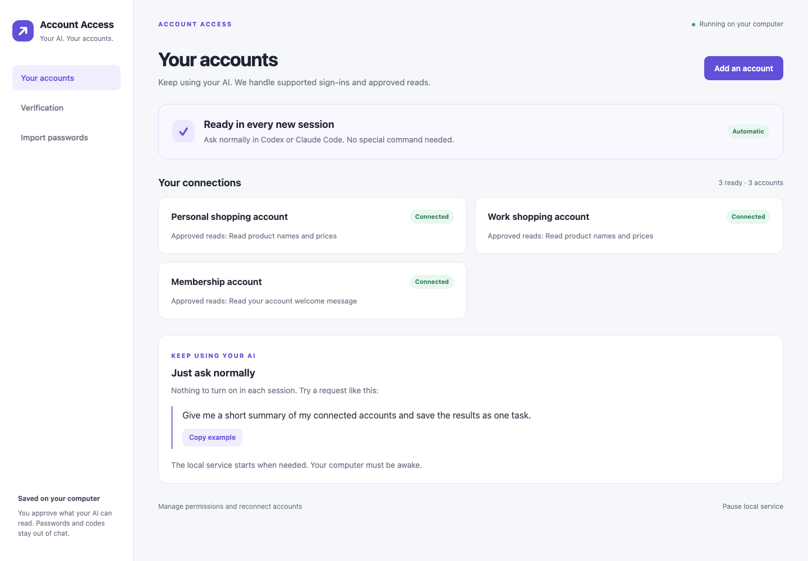
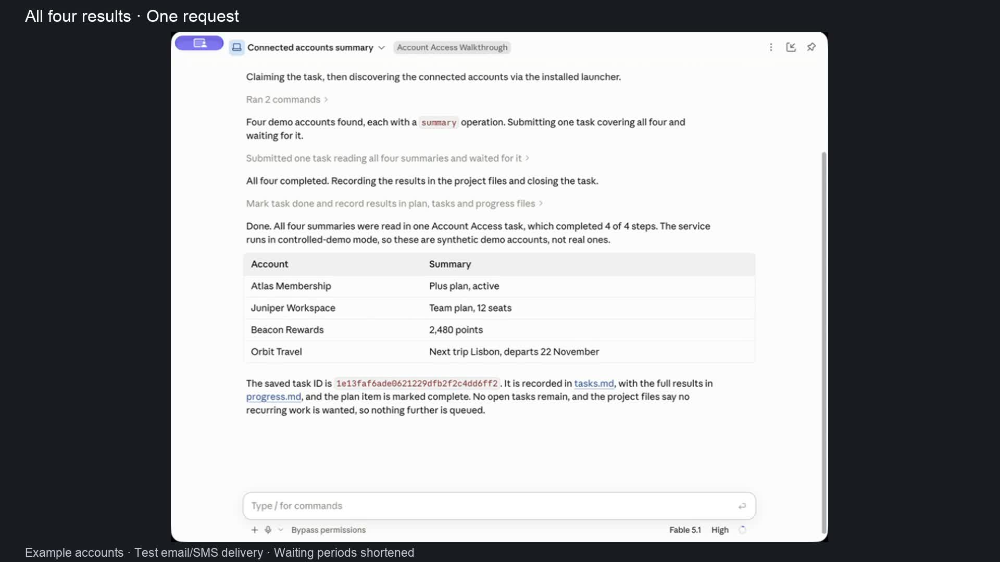
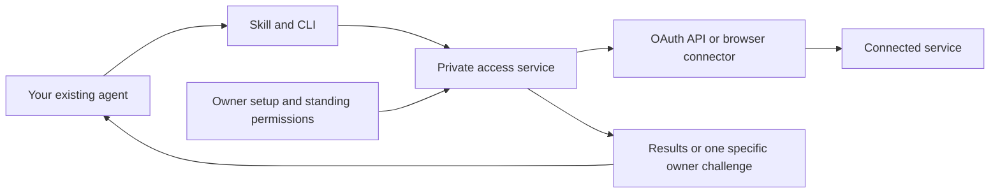
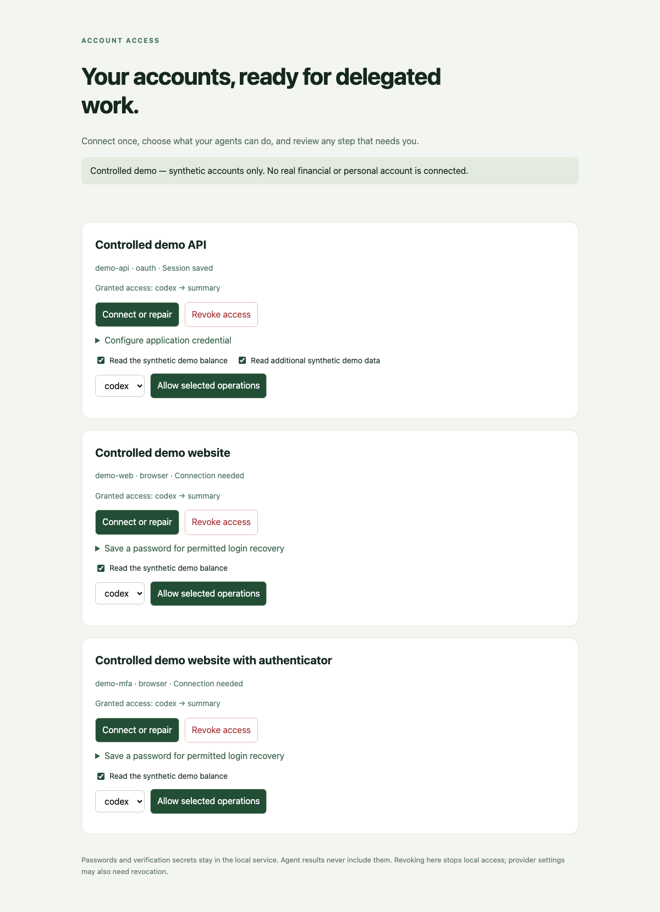

# Account Access

[](https://github.com/fainir/account-access/actions/workflows/check.yml)
[](LICENSE)

**Connect once. Grant specific permissions. Let your existing AI agent do the routine work.**

Account Access is a local authentication and delegated-access service for **Codex, Claude Code and other agents**. A portable skill and CLI let an agent request approved operations while the service manages credentials, sessions, renewal and resumable tasks. There is **no MCP dependency**.

**Status: 0.7.4 preview.** The included examples are usable today. Real websites require reviewed connectors; this is not an “add any website” consumer app or validated production access to banks, Google, Meta or insurance accounts.

This development branch contains the **0.8 candidate**: local Google Authenticator transfer import, reviewed SMS enrollment, and an installer that requires tested dependency hashes and can roll back a failed repair. These changes are under validation; the download below remains the published 0.7.4 preview. See [production acceptance and remaining gates](docs/production-gates.md).

The development candidate also includes a [Google Messages browser connection](docs/google-messages.md) for fresh GitHub login texts from an already-paired Android inbox. Its optional browser helper now also offers [verified GitHub session reuse](docs/browser-sessions.md): confirm the username locally and connect an existing Chrome sign-in. Cookie/site permission is optional and temporary. The unpacked-extension setup and private acceptance are still under validation.

The personal GitHub pilot now reuses an owner-approved Chrome session: its identity was checked locally, its original blocked task resumed, and fresh Claude Code and Codex sessions completed the approved profile-heading read without authentication input. A fresh password/SMS login still redirects to account recovery; personal email and authenticator sign-ins remain unverified. See the [private-session evidence](artifacts/private-github-session-080.json) and [validation report](docs/validation.md).

Further GitHub testing has stopped at the owner's request. The current candidate
adds a limited **Namecheap** password connection and exact password-export
aliases. Its anonymous form preflight passed, and one owner-approved private
credential was imported locally. The private check stopped at browser
verification/HTTP 429; password and email/TOTP sign-in remain unverified.
Railway's email sign-in was inspected but is
not yet a supported connector. See [other-service validation](docs/other-service-validation.md).

The browser sign-in flow uses the imported email/username and password, then supplies the website's email, SMS or authenticator login code from its connected source. A reviewed connector can configure all three methods for one website, including successive verification steps. This is the authentication flow being tested; using another application's existing login is not browser-authentication evidence.



## Easy installation

On a Mac, [download Account Access 0.7.4](https://github.com/fainir/account-access/releases/download/v0.7.4/Account-Access-Mac-preview.zip), unzip it, open **Account Access**, and click **Install Account Access**. The app prepares Python, the browser and the local service. No developer tools, terminal commands or administrator password are needed for this flow.

This is a **Developer ID signed preview**. Apple notarization is still pending, so Gatekeeper may block a fresh download. The recording verifies installation on our Mac, not a completed notarized distribution. See [Mac build and distribution notes](macos/README.md).

Have your AI tool installed and signed in. Account Access automatically installs one portable skill and CLI, with discovery folders for detected Codex and Claude Code installations. There is no agent-selection step. Other local agents can use the same CLI or load the skill from their supported folder.

Linux developers can use the [setup guide](docs/setup.md); browser libraries and sandbox configuration may require an administrator. Native Windows support is not implemented.

## Connect and use

1. Click **Import saved passwords**, select an export from your password manager, review matching supported accounts, and approve the reads you want your AI to perform. You can also enter one account's login locally.
2. Open **Verification** and connect the required email, SMS or authenticator source once.
3. When your accounts show **Connected**, open your AI tool and ask for the work in ordinary language.

For example:

> Find the cheapest item in my personal and work shopping accounts, and show my membership welcome message.

**No slash command or skill prefix is required.** New Codex and Claude Code sessions load the Account Access integration automatically. The agent discovers permitted operations and uses the saved account access when relevant. First-time installation requires a fresh session; existing conversations may already have cached their instructions. [Automatic session setup](docs/automatic-sessions.md) describes the supported hosts and limits.

The local service starts on demand when the installed client needs it. It reuses saved sessions and handles configured login challenges. If you deliberately pause it, open Account Access to resume. Genuine device, passkey, biometric or administrator approval remains a specific owner action.

The built-in catalog contains public SauceDemo shopping accounts and The Internet's public membership account. **Importing a password does not create a connector for an unsupported website.** An operator must supply a reviewed connector before private services can be connected. The four-factor recording uses separately configured, controlled example accounts.

### Passwords from Chrome and other managers

Export passwords as CSV, then choose that file in **Import saved passwords**. Supported layouts include Chrome, Apple Passwords, compatible 1Password CSV and Bitwarden login exports. [Google's export instructions](https://support.google.com/chrome/answer/13068232) and [Apple's export instructions](https://support.apple.com/guide/passwords/mchl35b12625/mac) describe their export flows.

The app shows matching account names and usernames, hides passwords, and saves only approved selections in the encrypted vault. Unsupported entries are not retained. A compatible authenticator seed or `otpauth://` URI can be imported **only when you explicitly enable authenticator import**. Passkeys and proprietary encrypted exports are not imported.

A CSV export contains plaintext passwords. The app can move that export to Trash after importing; it does not securely erase the file or empty Trash. Never send an export in chat or commit it to a repository. Account Access does not extract Chrome's encrypted password database silently.

**Keep passwords current:** CSV imports, including Chrome, are snapshots and need a fresh import after changes. An optional **Password sync** connection to an existing **1Password Connect** deployment checks exact approved items every five minutes and before password login. It updates only passwords; changed usernames, websites or connectors require review, and sync cannot add account permissions. The token stays encrypted locally. This requires an administrator-provisioned Connect server and read-only vault token; universal Chrome/other-manager live sync is not shipped. See [security and password sync](docs/security-and-password-sync.md).

### Email, SMS and authenticator codes

Follow the [Gmail, Google Authenticator and SMS setup guide](docs/gmail-authenticator-and-sms.md). It explains the current Gmail app-password route, the configured Google OAuth option, and why phone SMS pairing is separate from authenticator keys. The public preview does not bundle a ready-to-use Google OAuth application or import Google Authenticator's Transfer/Export QR format.

The 0.8 candidate adds local **Google Authenticator transfer QR import**. In **Verification**, choose an existing authenticator source, click **Import authenticator QR image**, select a complete export QR image, review the matching account, and import that entry. No key belongs in chat. Phone unlocking and export authorization remain a one-time owner step. Multi-QR batches and nonstandard TOTP settings are rejected.

The current candidate also offers **Check email connection**. It checks saved
mailbox access without fetching messages or starting a website sign-in. Setup
distinguishes **Setup saved**, **Mailbox connection checked**, and an account's
successful **Connected** state. Code delivery still needs its own website test.
See the [verification guide](docs/gmail-authenticator-and-sms.md) and
[candidate QA evidence](artifacts/mailbox-readiness-080.json).

In the latest development candidate, **Verification → Connect Gmail or email**
is available before a website is added. Save your Gmail app password once, or
enter another provider's TLS IMAP settings. Matching approved website sources
can reuse that encrypted mailbox. This does not add an unsupported website or
bundle a consumer Google OAuth application.
See the [installed setup screen and steps](docs/gmail-authenticator-and-sms.md)
and [reusable-mailbox validation](artifacts/reusable-mailboxes-080.json).

The current development candidate resumes saved work after a verified mailbox
repair or a local service crash. Pause stops recovery. Installation repairs keep
the previous runtime available and restore the launchers if an update fails.
Signed build **60** adds startup and update checks verified with a separate Mac
QA app, including cold startup from a retained managed environment. It is staged for testing; private-account
acceptance, installed owner upgrade, logout/reboot and notarized distribution
remain open. See [validation](docs/validation.md) and
[production acceptance](docs/production-gates.md).

| Method | One-time setup | During a supported login |
| --- | --- | --- |
| Email | Connect a configured TLS IMAP mailbox, or a reviewed Gmail OAuth connection | Read a fresh message matching sender, recipient, subject and template; submit its login code |
| iPhone SMS on Mac | Enable text forwarding to Messages, then grant the signed Account Access app Full Disk Access | Read incoming fresh Messages entries matching the configured sender and template |
| Android SMS | Pair the [phone preview](android/README.md), allow notification access and use the same private Wi-Fi | Forward a matching SMS-app notification to the certificate-pinned HTTPS login endpoint |
| Authenticator TOTP | Explicitly enroll a supported setup QR/key, or opt into a compatible seed import | Generate and submit the six-digit login code locally |

Email support depends on the provider exposing IMAP or the configured Gmail OAuth API; there is no universal webmail scraper. Gmail and other providers may require an app password or approved OAuth application. Existing authenticator codes cannot be recovered from every app: standard six-digit SHA-1 TOTP with a 30-second period is supported; push approval is an owner step.

Mac Full Disk Access and Android notification access are broader OS permissions than the app's own sender/template filters. The service consumes codes only within an active login window and rejects stale, duplicated or ambiguous messages. Passwords, cookies and codes are not returned through the agent API. Code sources can be disabled in owner setup.

The 0.8 candidate supports separate reviewed sources and form selectors for email, SMS and authenticator verification on the same account. It handles the methods actually presented by the website and can complete successive distinct challenges. A repeated challenge stops after one code submission; a payment, device, passkey or administrator requirement is not treated as another login-code form. See the [connector configuration example](examples/browser-verification.json).

When a website offers a choice, its connector can select a reviewed link to an enrolled verification method automatically. It checks the exact link before following it. A mandatory device approval still pauses. The owner app also offers a narrow sign-in-routing repair for the existing GitHub pilot, preserving its approved reads and login POST destinations.

For the existing GitHub browser pilot, the candidate adds **Connect iPhone SMS**.
After Messages forwarding and Mac privacy approval, the app requests one login
SMS and detects a recognized message locally. Review the sender and code-free
message pattern before connecting it. This one-time discovery checks at most 20
fresh incoming texts; later logins use the saved exact sender and template.
Sender changes or unsupported message formats require review. Live delivery
validation is separate from the fictional regression tests.

Connectors can also configure a separate **Send code** confirmation form. The
broker checks its reviewed POST destination and requests a code once before
waiting for delivery. It stops for repeated requests or changed forms.

Close the setup app when finished; your AI can start the saved local service when needed, including after a restart. Your computer must be awake and its secure keyring available. Use **Manage accounts and verification** to reconnect or revoke access.

## Watch the 85-second explainer

[Watch what Account Access does, how to use it, and its security basics](https://github.com/fainir/account-access/releases/download/v0.7.0/account-access-security-explainer.mp4).

[](https://github.com/fainir/account-access/releases/download/v0.7.0/account-access-security-explainer.mp4)

The narration explains how one-time setup reduces repeated login interruptions when your AI needs account access. The Gmail section shows its app-password setup fields; Google Authenticator uses the website's original setup QR/key, while the iPhone and Android options are for SMS text-message codes. Actual computer recordings show the public download, native 0.6 installer, password-export import, email/SMS/authenticator setup, and an ordinary request in Claude Code with no command or skill name. Four websites then sign in with saved passwords and configured verification codes; Claude returns all four results. Waiting periods are shortened. The accounts are fictional, email uses real local TLS IMAP with synthetic delivery, and SMS uses a Messages-format fixture. [Captions and recording evidence](docs/video/README.md) explain the setup and edit.

<details>
<summary>Developer installation and local test accounts</summary>

```sh
git clone https://github.com/fainir/account-access.git
cd account-access
uv sync --locked --python 3.13
uv run playwright install chromium
uv build
uv tool install --python 3.13 --force ./dist/account_access-0.8.0-py3-none-any.whl
account-access start
```

For a controlled development fixture with OAuth/password/TOTP accounts:

```sh
account-access --root "$HOME/.local/share/account-access-demo" demo --install
```

Keep that development-demo terminal open. These accounts contain synthetic balances and use a development key; keep this directory separate from real accounts. Append `--public-sites` to include published public website identities.

</details>

## How it works



The owner connects an account and grants named operations once. The agent can discover and execute those operations; it cannot choose arbitrary URLs, export credentials or grant itself more access through the service API.

The service reuses accepted browser sessions, refreshes eligible OAuth access and can perform configured password/TOTP recovery. If a provider requires genuine device, passkey, biometric or administrator approval, the task pauses with a specific challenge. Repairing access resumes checkpointed service steps. It does not automatically restart an entire terminated AI conversation.

## What works today

| Capability | Status |
| --- | --- |
| Portable skill + CLI | One shared client identity installed automatically; Codex and Claude Code exercised |
| Password imports | Reviewed CSV selections from supported layouts; optional explicit TOTP import |
| Password-source sync | Optional 1Password Connect exact-item password updates; contract and unattended rotation tests; Chrome/CSV remains a snapshot |
| Website username/email + password | Fixed reviewed forms, encrypted sessions and bounded recovery; public and controlled examples tested |
| Authenticator TOTP | Owner enrollment, setup QR/key and controlled end-to-end login |
| Email login codes | TLS IMAP end-to-end fixture; Gmail adapter contract tests; public mailbox delivery not validated |
| iPhone SMS on Mac | Signed narrow Messages helper tested against fixtures; physical text-forwarding delivery not validated |
| Android login notifications | Actual emulator notification → Keystore pairing → pinned HTTPS → browser code submission [passed CI](https://github.com/fainir/account-access/actions/runs/38543728385); physical phones not validated |
| OAuth code + PKCE and renewal | Controlled failure tests and external Duende demo refresh-token rotation |
| Passkey, fingerprint, device or admin approval | Genuine owner handoff |
| Existing Chrome session | Owner-requested GitHub session transfer; username/readiness verified before atomic save; controlled browser/native/helper tests; private acceptance pending |
| Payments, filings and account-changing writes | Unsupported; configured reads only |

macOS has been exercised locally. Linux is covered by the repository's CI workflow. Native Windows service transport is not implemented. A cloud agent needs a reachable HTTPS broker; installing a local skill does not expose your laptop's localhost to the cloud.

## Real accounts and owner setup

Real accounts require a **reviewed connector** with fixed operations, destinations and authentication markers. There is no automatic connector for an arbitrary website. The [Google Drive example](examples/google-drive.json) illustrates the API configuration; it needs a registered OAuth app and has not been validated on a private Google account.

Once that configuration exists, the owner initializes the vault, installs the agent clients, opens the local setup console, connects the account and selects permissions. Passwords and codes belong in that local flow, never in chat or GitHub issues.

See [real-account setup, other agents and Chrome instructions](docs/setup.md). For a distributed product, the operator should provide the approved OAuth applications instead of asking every end user to register one.

<details>
<summary>Preview the owner console (synthetic accounts)</summary>



</details>

## Durable tasks

For work that needs to survive an authentication interruption:

```sh
python3 "$HOME/.agents/skills/account-access/scripts/access.py" task submit \
  --key first-account-check \
  --steps 'demo-api:summary,demo-web:summary,demo-mfa:summary'
```

Copy the returned task ID, then:

```sh
python3 "$HOME/.agents/skills/account-access/scripts/access.py" task wait TASK_ID --timeout 60
python3 "$HOME/.agents/skills/account-access/scripts/access.py" task get TASK_ID
```

The worker preserves completed steps, retries temporary failures with backoff, and shares one unresolved authentication challenge across blocked tasks. Reusing the same key and steps returns the existing task. A new run needs a new key. Tasks and schedules require the service to be running and the computer awake; push notification delivery is not implemented.

## Troubleshooting

| Symptom | What to do |
| --- | --- |
| `account-access: command not found` | Run `uv tool update-shell`, then open a new terminal. |
| `service_unavailable` | Reopen Account Access, or start the configured service; use the skill for the intended installation. |
| Agent cannot find the skill | Start a fresh chat/session. The installer uses `~/.agents/skills/account-access` for Codex and `~/.claude/skills/account-access` for Claude. |
| Chromium is missing or cannot launch | Run `uv run playwright install chromium` in this checkout; on Linux also install its system dependencies. |
| Ubuntu browser still cannot launch | Have the administrator review the [per-binary AppArmor setup](docs/setup.md#linux-sandbox-setup). |
| `existing_skill_would_be_overwritten` | An unrelated directory already has that name. Review it or choose a custom supported skills directory; the installer does not overwrite unknown skills. |
| `NEEDS_USER` | Complete the specified step in owner setup. Preserve the same task ID. |
| Imported password saved, but sign-in is unfinished | The import summary preserves the saved login and explains the remaining check. Use **Show sign-in problem** in the owner app to display the actual website; a stopped page remains visible for up to two minutes. This does not change grants or send page HTML to the agent. |
| `DENIED` | Review the owner grant/configuration. The agent should not try another login path to bypass it. |
| Keyring unavailable/locked | Configure or unlock the supported OS keyring. File-key mode is for development demos, not production credentials. |

## Validation and development

Version 0.7.4 exposes those redacted navigation diagnostics in the authenticated owner app. A stopped account gets a plain-language explanation and an optional technical-details action. Only the fixed diagnostic format is returned; arbitrary audit text is excluded, and service diagnostics remain outside agent audit responses.

For 0.7.4, **93 Python tests**, native macOS UI checks and the Android emulator journey passed in CI. The signed update was installed through the graphical updater, and the actual owner diagnostic screen and detail dialog were checked. Both installed agent CLIs preserved an existing blocked private task using ordinary requests. A private provider redirect remained outside the reviewed flow; private sign-in and live mailbox/physical-phone delivery are still unvalidated. See the [sanitized installation and test evidence](artifacts/reinstall-074.json).

Version 0.7.3 adds bounded navigation-failure diagnostics for troubleshooting. The audit identifies a transport/HTTP failure or a blocked redirect and whether it matches an already configured resource path. It records a numeric resource index and query-presence flag, with no raw URL, query value, page text, headers, cookies or credentials. The destination allowlist remains enforced.

Version 0.7.2 keeps the import result visible when a website check fails instead of silently returning to an empty connection form. It refreshes the account state after verification, distinguishes a saved password from a verified connection, and adds an owner-only visible sign-in check. Normal agent reads remain headless, and the same destination and credential-entry protections apply in the visible check.

Version 0.7.1 fixes an AppKit constraint-order error that hid the new password-sync fields. A native regression check constructs the actual owner screen, verifies all four fields and the masked token control, and checks the minimum window size. The Python authentication and sync implementation is unchanged from 0.7.

The published 0.7.1 update was installed through the graphical updater and checked on the local Mac. Existing client identity, grants and configuration were preserved, the signed package pin matched, and the four password-sync fields were visible. Native macOS, Python and Android emulator CI passed. Claude Code and Codex each completed the three approved public-account reads from an ordinary request with no Account Access command in the prompt. Codex's configured default model was rejected before invoking Account Access; the isolated compatibility run used `gpt-6-astra` without changing saved settings. See the [installation evidence](artifacts/reinstall-071.json), [Claude Code evidence](artifacts/agent-tests/claude-implicit-071.json), [Codex evidence](artifacts/agent-tests/codex-implicit-071.json) and [default-model failure](artifacts/agent-tests/codex-implicit-071-default.json). These checks do not validate private-account access or physical phone delivery.

Version 0.7 checks on 15 October 2026: **91 Python tests passed**, including automatic password rotation with unchanged grants, blocked identity/destination changes, active code-window enforcement, safe file replacement and the four-factor controlled journey. Five external public-demo reads, their negative cases and session recovery also passed. Lint, the third-party dependency audit, package builds, strict verification of the signed universal Mac app and the revised video decode passed. Private-account enrollment, live Gmail/phone delivery and protection from unrestricted same-user processes remain unvalidated. See [0.7 evidence](artifacts/security-07.json), [public-site evidence](artifacts/public-demos-07.json) and [security/sync limits](docs/security-and-password-sync.md).

Version 0.6 validation on 14 October 2026: **75 Python tests passed** locally, with lint, dependency auditing and package building also covered by the [Linux CI workflow](https://github.com/fainir/account-access/actions/workflows/check.yml). Fresh ordinary-language requests activated the integration automatically: Codex completed a saved three-account task, and Claude Code completed the three approved reads and saved a comparison file. See [Codex evidence](artifacts/agent-tests/codex-implicit-06.json), [Claude evidence](artifacts/agent-tests/claude-implicit-06.json) and [automatic startup evidence](artifacts/automatic-start-06.json). The Codex test used an account-compatible model for that invocation; Claude's unrelated session-log hook encountered four permission denials after the account work succeeded. General host policies and hooks were retained. The [Android emulator journey](https://github.com/fainir/account-access/actions/runs/38543728385) passed separately. The [four-factor explainer recording](artifacts/video/gmail-authenticator-sms.json) verifies a completed Claude task at 4/4 with one plain-language request and zero password or code inputs during the task.

Earlier experiments on 12 October 2026:

- **43 regression tests passed.**
- **90/90 controlled repeated reads** completed unattended after programmatic demo enrollment.
- **25/25 external public-demo reads** completed across SauceDemo, The Internet and Duende, including ten rotating OAuth refreshes.
- **Codex and Claude Code each completed a five-account task**, independently verified through the service.

These accelerated results do not establish thirty-day reliability or private financial-account coverage. See the [full validation report](docs/validation.md) and [machine-readable evidence](artifacts/).

For public distribution on 13 October 2026, a clean-checkout installation completed the three-account demo, and [Linux CI passed all 43 tests, lint, dependency auditing and package building](https://github.com/fainir/account-access/actions/runs/38374863318). See [publication verification](artifacts/public-release.json).

```sh
uv run ruff check account_access tests scripts
uv run pytest -q
uv run pip-audit --local
uv run python scripts/benchmark.py
# Optional external network experiment with published demo identities only:
uv run python scripts/public_demos.py --runs 5
uv build
```

See [CONTRIBUTING.md](CONTRIBUTING.md) to add reviewed connectors and tests.

## Security and documentation

Credentials, sessions and task outputs are encrypted. Agent clients receive scoped identities, and every operation/result access rechecks standing permissions. Website content is untrusted. These controls do not isolate secrets from an agent with unrestricted shell access under the same OS user: strong credential custody requires a separate OS identity or host.

The development candidate includes an internal [separate-user worker component](docs/isolated-worker.md).
It passed [24 Linux cross-user checks](artifacts/worker-boundary-080.json) and
[25 Mac cross-user checks](artifacts/mac-worker-boundary-080.json), including
fictional password/email/SMS/authenticator sign-ins and denied agent access to
the vault and owner controls. The [Mac launcher](docs/mac-worker.md) validates
the protected runtime, permanently drops its OS identity and lets the kernel
close unapproved file handles. It still needs a production supervisor, trusted
enrollment and installer integration; it is not enabled in the consumer Mac app.

The [native Mac owner-channel component](docs/mac-owner-gateway.md) also passed
[54 checks](artifacts/mac-owner-gateway-080.json) with separate helper processes.
A separate [24-check integration](artifacts/mac-root-owner-080.json) deployed
the root host beside the isolated broker in a disposable Mac VM, verified peer
identity and revocation, and removed the service. This does not validate a
consumer installation or genuine owner approval. A separate
[20-check System-key journey](artifacts/mac-key-custody-080.json) verified daemon
restart recovery and denied another user's direct read. Production supervision
and native consumer wiring remain under implementation. A separate
[33-check native handoff](artifacts/mac-key-handoff-080.json) now opens an
encrypted fixture Store in the actual worker and verifies restart, crash
recovery, fresh owner capability and Pause. It is not consumer installation.

The same Mac VM passed [16 setup-policy checks](artifacts/mac-owner-policy-080.json):
strict rule provisioning, registrar binding, changed-rule rejection and fixture
cleanup. The proof test deliberately uses a synthetic permissive rule and does
not establish genuine owner presence or consumer enrollment.

Version 0.7 strengthens private file replacement, rejects vault-sidecar symlinks, requires an active matching window for every code resolver, and rechecks the verification page before filling its code. Native forms must POST to an approved destination. These checks run silently for supported normal logins. [Security and sync details](docs/security-and-password-sync.md) describe what is enforced and what remains outside the local preview's boundary.

- [Architecture and trust boundaries](docs/architecture.md)
- [Research and design choices](docs/research.md)
- [Setup and advanced usage](docs/setup.md)
- [Validation and remaining production work](docs/validation.md)
- [Security reporting policy](SECURITY.md)
- [TLS deployment example](deployment/nginx.conf.example)

## License

[MIT](LICENSE). Dependencies retain their own licenses.

## Guided setup validation (0.4.0)

On 13 October 2026, **50 distinct tests passed**: a 49-test regression run followed by 11 focused installation checks, including one added symlink-preservation case. The guided setup checks cover authenticated/CSRF-protected account connection, both agents' standing grants, shared session reuse, refusing unreviewed destinations, a launcher that needs no Python on PATH, and reopening/stopping the background app. The installer rejects modified downloads before executing them, and local app startup rejects an impostor on a reused port. Dependency auditing found no known vulnerabilities in the third-party packages. A live screen recording of the guided interface is still pending.
