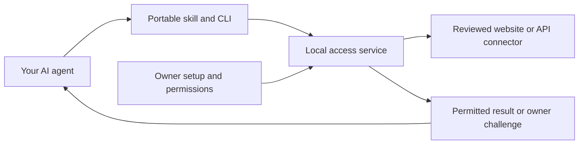

# Account Access

[](https://github.com/fainir/account-access/actions/workflows/check.yml)
[](LICENSE)

**Connect once. Let your AI agent handle routine sign-ins.**

Account Access is a local service that manages saved passwords, sessions and
configured login codes for approved account operations. Ask your existing AI
agent for the work in ordinary language. Its portable skill and CLI use Account
Access automatically when relevant, without a slash command or an MCP server.
Codex and Claude Code have been exercised; other local agents can load the same
skill or use the CLI.

**Public download: 0.7.4 preview. Development candidate: 0.8.0. Neither is a
production release.** Websites need reviewed connectors; importing a password
does not make an arbitrary website supported. Private password/code logins,
physical phone delivery and notarized consumer installation remain unverified.
The 0.8 Mac runtime targets **Apple silicon and macOS 14 or later**. See the
[current production gates](docs/production-gates.md).


## Easy installation

1. On your Mac, [download Account Access 0.7.4](https://github.com/fainir/account-access/releases/download/v0.7.4/Account-Access-Mac-preview.zip).
2. Unzip it and open **Account Access**.
3. Click **Install Account Access**. The preview prepares its runtime, browser,
   local service and agent integration. This flow needs no terminal commands or
   developer tools.

Have your AI tool installed and signed in first. Setup detects Codex and Claude
Code and installs one shared skill; there is no agent-selection step. Start a
fresh agent session after installing so it loads the new instructions.

The preview is Developer ID signed, but Apple notarization is pending. A fresh
download can be blocked by Gatekeeper; installation on a clean separate Mac has
not been validated. The protected 0.8 installer is still under development and
is **not** the download above. [Mac distribution notes](macos/README.md).

Linux has a [developer setup guide](docs/setup.md#linux-sandbox-setup). Native
Windows support is not implemented. A cloud agent needs a reachable HTTPS
broker; a local skill does not expose your computer's localhost to the cloud.

## Connect and use

1. Choose **Import saved passwords**, select a local password export, and review the
   supported accounts that match. Approve only the account reads you want.
2. Open **Verification** and connect the login-code sources those accounts use.
3. Check that the account shows **Connected**, then ask your AI for the work.

For the included public shopping and membership examples:

> Find the cheapest item in my shopping account and show my membership welcome message.

The agent discovers your permitted accounts and operations. Account Access
reuses an accepted session or performs the configured password and verification
steps locally. It starts its saved local service when needed. Your computer
must be awake and its secure keyring available. If you pause access, reopen the
app to resume it.

The built-in catalog includes public SauceDemo and The Internet test accounts.
The 0.8 candidate also includes narrow Namecheap and PyPI pilots; private
acceptance is unfinished. PyPI supports the reviewed password/authenticator
route. In **Verification**, you can link an already checked mailbox for PyPI's
new-device confirmation emails without editing configuration. This picker uses
checked Google browser connections or saved TLS IMAP connections, including Gmail
app-password mailboxes. Google browser consent requires a configured publisher
application; consent is followed by a mailbox-address check.
[Connect PyPI confirmation email](docs/device-email-setup.md).
[Provider coverage and limits](docs/other-service-validation.md).
Other private websites require an operator-supplied reviewed connector. A provider's
mandatory passkey, biometric, phone unlock or administrator approval still needs
the owner. [Automatic sessions and their limits](docs/automatic-sessions.md).

### Import passwords and keep them current

Export passwords from Chrome or your password manager, then select the file in
**Import saved passwords**. Supported layouts include Chrome, Apple Passwords,
compatible 1Password CSV and Bitwarden CSV. The 0.8 development candidate also
accepts unencrypted Bitwarden JSON with multiple website addresses per login;
cards, notes, passkeys and deleted entries are not imported.
[Supported files and import review](docs/password-import.md).
[Chrome export instructions](https://support.google.com/chrome/answer/13068232)
and [Apple export instructions](https://support.apple.com/guide/passwords/mchl35b12625/mac).

The app hides passwords during review and saves only approved selections in its
encrypted vault. Unsupported entries are not retained. CSV and unencrypted JSON exports contain
plaintext passwords: keep them local and use the app's option to move the export
to Trash afterward. This does not securely erase it or empty Trash. Never upload
an export or paste credentials into chat.

**Chrome and other CSV imports are snapshots.** Re-import after changing a
password. The 0.8 candidate supports ongoing updates from exact approved
1Password items using a read-only service account, without a Connect server.
Existing Connect deployments also work. Checks run every five minutes and
before password login when due; changed usernames/sites need review. Chrome
live sync is not shipped. Editing a saved login replaces its previous manager
connection, so sync cannot undo your edit.
[1Password setup](docs/onepassword-sync.md) and
[password-sync details](docs/security-and-password-sync.md).

### Connect email, SMS and an authenticator

| Login-code source | One-time local setup | During supported sign-in |
| --- | --- | --- |
| Gmail | Connect with a Google app password, or an operator-configured Gmail OAuth connection | Read a fresh matching login email and submit its code |
| Other email | Connect your provider's TLS IMAP mailbox | Read a fresh matching login email and submit its code |
| iPhone SMS on Mac | Enable text forwarding to Mac Messages and grant the signed app Full Disk Access | Read a fresh incoming text matching the approved sender and template |
| Android SMS | Pair the [Android preview](android/README.md), grant notification access and use the same private Wi-Fi | Deliver a matching SMS-app notification over pinned HTTPS |
| Authenticator TOTP | Enroll the website's original setup key or supported QR locally | Generate and submit its changing six-digit code |

See the [step-by-step Gmail, SMS and Google Authenticator guide](docs/gmail-authenticator-and-sms.md).
The public preview has no ready-to-use consumer Google OAuth application, and
some Google accounts cannot create app passwords. Email support depends on a
configured Gmail API or TLS IMAP connection; arbitrary webmail is not supported.

Google Authenticator setup uses the website's secret key; it does not read codes
from your phone screen. The 0.8 candidate also accepts a complete Google
Authenticator transfer batch: select all QR images from the same export
together, then review the matching account locally. Up to 16 parts and 100
supported TOTP entries are accepted; only your selected account is enrolled.
Missing, duplicate or mixed parts are refused. Phone export authorization is an
owner step. Push approvals, nonstandard TOTP settings and Authenticator cloud
sync are not supported.

Codes are consumed only during an active matching login. Stale or ambiguous
messages stop recovery. Passwords, cookies and codes are not returned through
the agent API. Mac Full Disk Access and Android notification access are broader
OS permissions than the app's own message filters. **Mailbox connection
checked** confirms mailbox access; it does not prove website code delivery.

## Watch the 85-second explainer

[](https://github.com/fainir/account-access/releases/download/v0.7.0/account-access-security-explainer.mp4)

[Watch the installation and use recording](https://github.com/fainir/account-access/releases/download/v0.7.0/account-access-security-explainer.mp4).
It shows a computer downloading/installing the earlier 0.6 app, importing
passwords, configuring verification and asking Claude Code for work without a
special command. The accounts are fictional. Email uses synthetic TLS IMAP
delivery; SMS uses a Messages-format fixture. The Gmail setup fields do not
demonstrate a completed real Gmail connection. Waiting is shortened.
[Captions and recording evidence](docs/video/README.md).

## How it works



The owner grants named operations once. The agent cannot choose arbitrary
destinations or grant itself access through the service API. Saved tasks can
resume supported steps after temporary failures or repaired authentication;
this does not restart an entire stopped AI conversation.

The preview encrypts credentials, sessions and task outputs, but it does not
protect them from unrestricted tools running as the same OS user. The 0.8
candidate adds a separate Mac service identity, native owner authorization,
protected key custody and an offline installer. Controlled cross-user tests
pass; genuine consumer setup, updates/reboot and private sign-in QA remain open.
[Architecture](docs/architecture.md), [security boundaries](docs/security-and-password-sync.md)
and [Mac installation work](docs/mac-system-provisioning.md).

## Troubleshooting

| What you see | What to do |
| --- | --- |
| Agent cannot find Account Access | Start a fresh session. See [automatic setup](docs/automatic-sessions.md). |
| Imported entry is unsupported | A reviewed website connector is required; importing alone cannot add one. |
| Password saved, account not connected | Open **Show sign-in problem** in the app and complete the specified repair. |
| `NEEDS_USER` | Complete the specific owner step locally. Keep the same task; do not send secrets in chat. |
| `DENIED` | Review account permissions locally. The agent must respect the denial. |
| Service unavailable or deliberately paused | Reopen Account Access and resume it. |
| Password changed since import | Import the current export, or repair your approved password-sync connection. |

## Development and evidence

```sh
git clone https://github.com/fainir/account-access.git
cd account-access
uv sync --locked
uv run playwright install chromium
uv run pytest -q
uv run ruff check account_access tests scripts
uv build
```

Tests use controlled accounts unless explicitly labelled otherwise. Native
privileged acceptance belongs in disposable CI Macs. Do not run those harnesses
against an owner's installation. Current CI results do not establish successful
private authentication or physical phone delivery.

- [Validation and production gates](docs/production-gates.md)
- [Detailed test evidence](docs/validation.md) and [machine-readable reports](artifacts/)
- [Completed email-setup validation at source 1bba84f](artifacts/consumer-mail-setup-080.json)
- [Earlier mailbox authorization and sync repair results](artifacts/mail-source-authority-080.json)
- [Earlier import and Gmail repair results](artifacts/unattended-import-080.json)
- [Earlier connected setup and canonical installation results](artifacts/connected-setup-080.json)
- [Earlier verification-authority and signed-Chrome results](artifacts/verification-authority-080.json)
- [Resumable installer verification results](artifacts/resumable-installer-080.json)
- [Genuine publisher and runtime checks](docs/publisher-runtime-checks.md)
- [Preview validation history](docs/preview-validation-history.md)
- [Current agent QA boundary](docs/agent-qa-boundary.md) — Claude passes controlled fictional login; local Codex QA stops before startup until its permissions can be attested.

That Codex preflight belongs to the optional isolated CLI test harness. The
installed skill and client do not run it. Protected setup also supports an
explicit upgrade from a recognized preview connection, preserving personal
instructions and tool settings. See [agent setup and upgrades](docs/mac-agent-setup.md).
- [Advanced setup and other agents](docs/setup.md)
- [Contributor guide](CONTRIBUTING.md) and [security reporting](SECURITY.md)
- [Research and design](docs/research.md)

## License

[MIT](LICENSE). Dependencies retain their own licenses.
