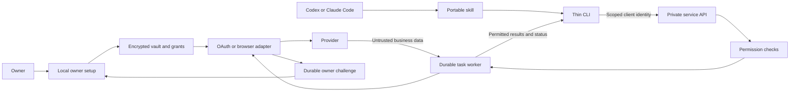

# Account Access architecture

The accepted architecture is a portable Agent Skill and a thin CLI over an independent service. Authentication and permission enforcement belong to the service. MCP is not a dependency. The original research evaluated MCP as an interface; the later product discussion chose a protocol-neutral service instead.

## Boundaries

Agent clients have no credential export or permission-grant API. The client identity is resolved from a high-entropy bearer credential whose digest is held by the service; it cannot be selected in an operation payload. Each account exposes fixed named read operations. Inputs are validated with unknown fields forbidden. A portable script runs only the client command set. Configurations, session import and owner setup are outside the agent API.

The local API binds a private Unix-domain socket, with bearer authentication even on that socket. It rejects browser Origin/Cookie requests, caps request bodies and response payloads, suppresses access logs and emits fixed errors. The owner console is a separate ephemeral loopback server with a bootstrap capability in the browser URL fragment, exact Host/Origin validation and no third-party assets. It never returns credential values. These are separate interfaces, not merely different labels on the same API.

Local same-user access is appropriate for a trusted-agent pilot, not strong isolation against arbitrary shell execution. A compromised agent with owner filesystem/keychain access can bypass broker interfaces. Isolated deployment is a release requirement for that threat model. The HTTPS client can reach a broker on another host; TLS reverse-proxy configuration is supplied. Multi-tenant hosting, a token issuance UI for remote clients and native Windows transport are not shipped.

## Authority and operations

Standing grants bind principal, account, named operation, owner configuration fingerprint and optional expiry. The owner chooses them once. Every operation and task result access rechecks them. Provider OAuth scopes are also checked before an API read. Configuration drift fails closed until reviewed, granted and reconnected. A revoked principal cannot read its earlier results. A local account revocation stops new operations but cannot retract an already issued HTTP request or invalidate a provider token by itself.

Browser operation URLs/resources are exact allowlists; read mode blocks POST, external URLs, WebSockets, service workers and downloads. Login POST destinations have a separate exact allowlist. Main-frame requests use Chromium's native transport, preserving redirect URLs, browser cookies, headers and TLS behavior. A private CDP session pauses each response before Chromium follows its redirect and validates the exact destination and resulting HTTP method. Ordinary Playwright routing checks only the first request of a redirect chain, so the response check is necessary to prevent a 307/308 from carrying a password to an unapproved destination. No debugging port or browser handle is exposed to the agent. Child-frame and worker requests retain bounded fetching with automatic redirects disabled and each hop checked separately; their final response is fulfilled at the originally requested URL. At most six requests per chain are made. Responses above eight MB are rejected after buffering; this is not a streaming browser memory limit.

JavaScript is off unless explicitly configured. Password entry happens only in a configured login form at the exact login URL; an unrecognized page never triggers guessing or credential entry. Configured state markers are polled for a bounded period so asynchronous applications can finish rendering. A named GET is only as read-only as the reviewed provider semantics: a website can implement side effects through GET, so arbitrary URLs are not exposed.

Returned text is data, never authority. Model-side instructions are useful routing, but server checks are decisive. Credential keys and known secret values are redacted defensively. A provider could encode unknown secrets in business data; this mechanism is not a universal data-loss-prevention proof. Browser/network containment and minimal output selection reduce the exposure surface.

## Credential and session lifecycle

OS keyring custody is default; only secure backends are accepted. A raw file key requires explicit development mode and is used only for synthetic tests/demo. The root is 0700 and sensitive files are 0600; symlinks and unsafe owner/permission states are rejected. AES-GCM records use a fresh nonce and their record ID as associated data, detecting tampering and record swaps. Business outputs are encrypted too. Audit metadata excludes provider bodies, passwords, codes and business outputs. SQLite WAL and FULL synchronization preserve transaction consistency.

OAuth enrollment uses an external browser, loopback callback, unique state and PKCE S256 through Authlib. Callback location, state, code count, expiry and configuration binding are checked. Authorization state is consumed before exchanging the code. Callback URLs are never logged.

Refresh and account operations share a cross-process account lock. Rotated token replacement is durable. A persisted in-flight refresh marker is set before network I/O. A crash or lost response can leave the old refresh token invalid: the marker prevents blind replay and requires owner reconnection. `invalid_grant` stops renewal and creates a single challenge. An API 401 permits one refresh/retry; 403 scope/permission failure does not become a login retry. Provider 429/5xx read errors produce backoff without a human challenge. Unknown token expiry is not treated as permanent access.

Browser state persists cookies/localStorage/IndexedDB without dumping plaintext auth files. Each run creates a new isolated context with restored state. Configured expired-login detection can trigger one password login and an approved factor; a cooldown and durable challenge stop repeated attempts after failure. Real-site fingerprints, sessionStorage and device/hardware binding remain compatibility limits.

## Verification channels

TOTP is generated inside the service from an explicitly enrolled login-only seed. Email/SMS adapters use configured account/source, sender, recipient, receipt time and exact message template. Multiple matching messages stop as ambiguous. Codes are submitted once to the active configured login form. The submitted code and known source secrets are added to the per-operation redaction set, so a provider echoing that code does not expose it in the tested task output. Unknown or encoded secrets remain outside any universal redaction guarantee.

Gmail source access uses its separately connected OAuth account and gmail.readonly scope. Broker filtering is narrower than that OAuth scope; owner consent must acknowledge the provider scope. Sender matching is not cryptographic proof of the service's identity, so exact template, active challenge binding and provider verification are also required; live sender/provider contract validation remains outstanding. Twilio supports only an owned supported number/gateway; it is not a generic native phone inbox reader.

Challenge detection prioritizes action/passkey/device/admin over login readiness. An action challenge cannot consume the login TOTP source and is not resolved by ordinary reconnection. Genuine required biometric or device presence remains the owner's step.

## Durable work

Tasks have an owner-independent lifetime and per-principal idempotency keys. Reusing a key with different steps is rejected. A job lock prevents simultaneous advancement. Completed steps and outputs are saved atomically with queue state. Permission is rechecked per step and before exposing results. A read completed remotely but not checkpointed may replay after a crash; no writes are implemented.

One durable challenge is shared per account/category. While unresolved, pending jobs do not repeat provider requests. Reconnection resolves login challenges and the worker continues the same jobs. Task metadata does not automatically wake a stopped AI chat; a host integration would need a supported callback or scheduled agent run for that.

Schedules retain an immutable reviewed step list, principal and interval. Invalid/revoked grants disable the schedule. Missed intervals coalesce rather than generate a burst. Notification delivery is deliberately separate from authentication: the skill is instructed to present the same challenge once, but cross-chat notification deduplication/delivery is not measured or implemented as a push service.

## Expansion

Add provider adapters with explicit operations and recorded challenge contracts. Evaluate managed OAuth infrastructure such as Nango/Composio/Pipedream behind this interface for a larger catalog. Evaluate agent-browser as a browser runtime, but do not expose its unrestricted credential/browser commands to the model or treat its opt-in policy features as a substitute for operation grants. The initial implementation reuses Playwright directly because the experiment needs fixed operation-level control.

The Chrome native session bridge is an experimental owner convenience, with exact extension registration and account origin filtering. It exports no password vault, passkey or authenticator. The extension/native host is not a publicly distributed signed consumer installer and has not been exercised with live Chrome accounts.

Production release requires named live-service pilots, the intended isolated custody deployment, provider app registrations and conditions, mobile channel validation, installer/update signing and operational monitoring. See validation.md for what was actually tested.
