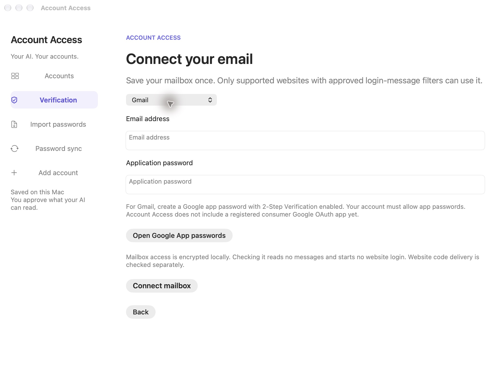
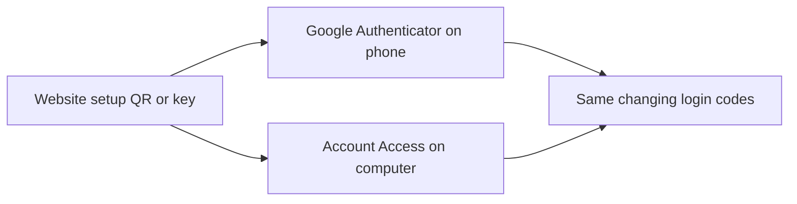

# Connect Gmail, Google Authenticator and SMS codes

These are three separate ways a website can verify a sign-in:

| Where you normally find the code | What Account Access uses |
| --- | --- |
| A message in Gmail | A connected mailbox and a reviewed filter for that website's login messages |
| Google Authenticator on your phone | A copy of that website's original authenticator setup key |
| An SMS text message on your iPhone or Android phone | Forwarded Messages on a Mac, or the paired Android SMS companion |

## Gmail

Google recommends **Sign in with Google**. Account Access supports an operator-configured Gmail OAuth connection, but the public preview does not include a registered, ready-to-use Google OAuth application. A generic “Connect verification” button is not evidence that this setup has been completed. [Google's Gmail connection guidance](https://support.google.com/mail/answer/7126229).

The consumer OAuth path needs a publisher-registered desktop client. Google's
[desktop flow](https://developers.google.com/identity/protocols/oauth2/native-app)
uses the external browser with PKCE and a local callback. For broad consumer
release, the `gmail.readonly` scope also requires Google's restricted-scope
verification. [Gmail scope requirements](https://developers.google.com/workspace/gmail/api/auth/scopes).

**Current 0.8 candidate:** when the publisher has configured that Gmail
connection, **Verification → Connect with Google** opens Google's genuine
consent page in your default browser. Select the mailbox approved for the
website's login messages, review Google's mailbox read permission, and return
to Account Access. No Google password, app password or copied authorization
code is entered in Account Access. The same connection can support the
website filters already configured for that mailbox. Enable or check each
website's email verification to confirm its approved mailbox address; saving
Google access alone does not verify delivery or start a website sign-in.

The protected Mac installation runs its loopback callback in the signed
desktop app. It sends the response through the owner channel to the isolated
worker, where PKCE, state, token exchange, encrypted token storage and renewal
remain. Callback host, path, method, state and size are checked; attempts expire
after five minutes and cannot be replayed. Cancelling preserves any existing
Google connection. This handoff removes the former requirement for the
isolated worker to launch a browser in the owner's desktop session.

These controls have synthetic provider and local callback tests. They do not
establish a completed real Google consent, verified Google application or real
email-code delivery. If no registered connection is configured, the app explains
that publisher requirement and offers the app-password alternative below.
An operator template is [gmail-oauth.json](../examples/gmail-oauth.json); its
placeholder client ID and message filter are not a ready-to-use connection.

The video shows the **Gmail app-password option**, for accounts where Google permits it. A reviewed connector must already configure its email-code source with Gmail's mail server, `imap.gmail.com`, port `993`. That makes the source appear in **Verification**; importing a website password alone does not create a mailbox connection.

You can also connect a reusable TLS IMAP mailbox before adding a website.
Open **Verification → Connect Gmail or email → Use an app password**, keep **Gmail** selected, and enter
your email address and Google app password locally. The app supplies Gmail's TLS
IMAP settings. A read-only connection check fetches no messages and starts no
website login. **Other email · TLS IMAP** accepts your provider's server and port.
This is mailbox setup, not universal access to every webmail service.

The encrypted mailbox is reusable: a website's existing approved email source
can select it when its exact recipient, server and port match. A single checked
match is preselected for a new source, so you do not enter the app password again.
Click **Connect verification** to check that website's sign-in. A mailbox cannot
create a website connector, change its message filter, or grant more account reads.
Disconnecting it stops future email-code recovery; an existing website session
can continue under its existing permissions.

**Update app password** changes only the encrypted local mailbox password;
the email address and server stay fixed. **Disconnect mailbox** removes that
local connection and stops future/pending code reads. It does not revoke the
Google-issued app password at Google or revoke independent website permissions.
Temporary mailbox outages retry automatically during delegated work; rejected
credentials or a certificate-verification failure require local repair.

In the newest development candidate, a verified repair of a recognized mailbox
access problem can resume its original queued task automatically. The service
requires its saved source context, unchanged permissions/configuration and a
fresh mailbox check. A delivery timeout, ambiguous code or website security/
device/action challenge still needs its specific repair; checking the mailbox
does not clear it or mark website sign-in successful. Historical challenges
without a bound source remain available for explicit owner review.

The following source-specific steps also apply to the published 0.7.4 preview:

1. Open your [Google Account's App passwords page](https://myaccount.google.com/apppasswords). Sign in yourself. This option requires Google's 2-Step Verification.
2. Create an app password for **Account Access**. Google generates this separately from your normal Google password.
3. In Account Access, open **Verification**, select the configured Gmail email source, and check that its mail server is `imap.gmail.com`.
4. Enter your Gmail address and paste the app password into **Mailbox application password**, locally in the app. Click **Connect verification**.

Some work/school accounts, Advanced Protection accounts and security-key-only setups do not offer app passwords. Use a configured Google OAuth connection in those cases. [Google's app-password instructions and availability rules](https://support.google.com/accounts/answer/185833).

During a supported website login, Account Access retrieves a fresh email matching that website's approved sender, recipient, subject and message template. It submits the login code to the website. It does not expose the inbox or code through the agent's account API.

The current 0.8 candidate checks the mailbox connection when saving email setup.
You can also select **Check email connection** to test the saved setup without
starting a website sign-in. TLS IMAP checks authentication, read-only inbox
selection and message tracking; the configured Gmail OAuth route reads the
[Gmail profile](https://developers.google.com/workspace/gmail/api/reference/rest/v1/users/getProfile)
and verifies the approved mailbox address. Neither check fetches messages.
**Mailbox connection checked** means email access passed that check; it does
not mean a website has delivered a code or completed sign-in. Other saved
verification sources display **Setup saved** until the website check succeeds.

The IMAP reader searches from the pre-login UID boundary, rejects excessive or
incomplete results, and verifies each fetched message's UID. It cannot silently
choose from the last twenty messages while hiding other matches. Changing or
disabling the source invalidates the saved connection-check result.

The 0.8 candidate supports plain-text and HTML-only login messages. Formatting
can vary, but the approved words and login purpose must match; Account Access
does not guess a six-digit number from an arbitrary email. It never opens email
attachments, executes message HTML or loads remote images. Existing messages,
ambiguous matches and incomplete mailbox results cannot supply a code. A Gmail
OAuth connection is checked before password submission and can renew expired
access through its existing authorization. These parser and renewal checks have
controlled tests; a real connected Gmail mailbox remains a separate QA gate.

The new recording explains Google's app-password prerequisite and shows the real native form configured for Gmail. It uses an example address and masked example app password without submitting them. It does not record the creation of a real Google credential or a completed Gmail connection. The later email-code login remains the independently verified TLS IMAP test delivery from the four-account task.

## Google Authenticator on your phone

Google Authenticator generates codes using a setup key originally supplied by the **website**. Account Access can use that same key to generate the same changing codes on your computer. Your phone can keep using Google Authenticator. A Gmail connection does not connect the Authenticator app. [Google's explanation of Authenticator codes](https://support.google.com/accounts/answer/1066447) and [Google's setup-QR format](https://github.com/google/google-authenticator/wiki/Key-Uri-Format).

1. Get the website's original authenticator setup QR or setup key from its two-step verification settings. When first enrolling, this is the QR you scan with Google Authenticator on your phone.
2. In Account Access, open **Verification**, select that website's authenticator source, and choose **Read a setup QR image**, or enter the setup key locally.
3. Click **Connect verification**. During later supported sign-ins, Account Access generates and submits the code using its saved key.

If the current code is about to expire, the 0.8 candidate waits a few seconds for
the next code before submitting it. This does not require an owner prompt.

If the website already uses Google Authenticator and you no longer have the original QR/key, follow that website's owner flow to obtain or re-enroll it. If it supplies a new key, update both your phone app and Account Access with the new key yourself.

The published 0.7.4 preview accepts a website's standard `otpauth://totp/` setup QR/key: six digits, a 30-second period and SHA-1. Its importer does not accept Google Authenticator's different “Transfer codes / Export codes” format. **The 0.8 candidate adds local transfer-QR import:** choose **Import authenticator QR images** and select all images from one Google Authenticator export together. Select the matching account before importing. Up to 16 QR parts and 100 six-digit SHA-1 TOTP entries are supported; their batch identity, size and every part index must match. Missing parts, duplicates and mixed exports are rejected without changing enrollment. Only your selected account is enrolled; the other keys are discarded. Previews are encrypted, expire after ten minutes and become invalid if you replace or disable that source. Importing the selected key and consuming its preview commit together. The app does not read your phone screen or retrieve keys from Google's Authenticator cloud sync. Never send a private setup QR/key in chat.

Fingerprint, passkey, push, device and administrator approvals remain owner actions; they cannot be replaced by generating an authenticator code.

## iPhone and Android: these connections are for SMS text-message codes

**iPhone with a Mac:** Make SMS appear in Messages on your Mac using Messages in iCloud or text forwarding. For explicit forwarding, on your iPhone go to **Settings → Apps → Messages → Text Message Forwarding**, then enable your Mac. Use the same Apple Account on both devices. In Mac privacy settings, grant the signed Account Access app Full Disk Access, then enable its iPhone Messages source. [Apple's forwarding instructions](https://support.apple.com/102545).

**Android:** Install and pair the [Account Access phone companion](../android/README.md), permit notification access, and keep it on the same private Wi-Fi as the computer. Its job is to relay matching SMS-app login notifications to Account Access's pinned HTTPS endpoint. It does not connect Google Authenticator.

These OS permissions are broader than the app's sender/template filter. Account Access uses matching fresh codes during an active supported login. The video shows setup instructions; physical phone delivery has not been validated. The recorded SMS login uses a test Messages database, and the separate Android emulator journey is described in the phone companion's documentation.
