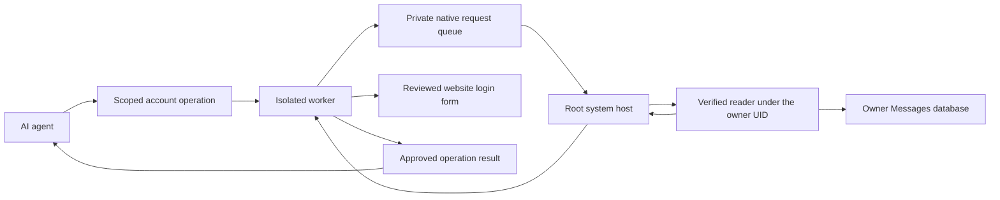

# SMS collection across the protected Mac boundary

The candidate's isolated worker cannot use the legacy same-user Messages reader:
its home and credentials belong to a dedicated broker identity. The new bridge
keeps the Messages database under its actual macOS owner and sends a matching
login code through private service channels. This development path is not enabled
in the published preview and is not physical-phone acceptance.

The agent receives the approved operation result. There is no agent API to read
messages, fetch codes, choose a database, select a reader command or change a
verification source. Native owner XPC also refuses the internal collector routes.
The existing private owner Unix socket and its per-worker capability carry the
root host's fixed collector requests.

## Normal operation

Before password submission can trigger a text, the worker publishes a short
pending login window bound to the configured source and enrollment. The root
host starts the pinned app's headless reader as that OS user using the system's
`launchctl` and `sudo`. These calls occur inside the already installed system
service; they do not request elevation or ask the owner for a password.

The reader verifies the root broker’s kernel-issued socket identity against the root-controlled desktop
profile. The anonymous Unix socket retains the creating broker’s audit token across
`launchctl` and `sudo`. The reader verifies its real/effective root UID and pinned
code signature using that token, including its process-version identity. The root host waits for a small PID announcement and verifies the actual
reader's code signature, real/effective/saved user IDs, process birth identity
and ancestry under its own launched process before sending request metadata.
This also protects against substituting an executable between static verification
and launch. Requests and replies use that inherited private socket; it has no filesystem
listener. No broker key,
mailbox password, account password or legacy reader key is copied to the owner.

The first query returns only a row baseline. Later queries read incoming texts
from the exact sender after that baseline and within the active time window,
match the literal configured login template and exclude used message IDs.
Multiple matching messages and truncated result sets are refused. Messages dated
beyond the small allowed clock offset or beyond the login window are excluded. Both the reader and worker recheck
freshness; the worker rechecks enrollment, cancellation and source changes after
delivery and before using a code. A late, replaced or revoked request cannot
supply a code to the login flow.

The queue is memory-only, limited to four pending requests, bounded metadata and
single-use IDs. A request times out after eight seconds; the reader process has
a five-second budget. Stop closes the queue and rejects pending replies. Root
and reader failures produce fixed reason codes without logging message text or
codes. Protected app builds disable the legacy HMAC reader entry point.

## Permission and verification limits

The system job declares the owner app in `AssociatedBundleIdentifiers`, following
[Apple’s guidance on responsible code](https://developer.apple.com/forums/thread/678819).
That association is metadata, not a privacy grant or proof that the launched
reader has inherited an existing grant. The installed chain must be tested with
real OS approval on a clean Mac.

macOS still requires the owner to enable SMS forwarding and grant Full Disk Access
where required. This bridge does not grant that permission or approve a device
challenge. Full Disk Access is broad OS permission; the implementation restricts
its own queries to the configured login source. It does not make all messages on
an owner's device inaccessible to other software the owner has authorized.

Python checks cover private Unix authorization, absent agent routes, revocation,
cancellation, timeouts, bounded requests and replies, queue capacity and baseline
failure cleanup. A synthetic browser journey completes password/SMS login through
the private Unix collector transport, reuses its session and stops code submission
after source revocation. It does not run the native reader or change OS users. The disposable Mac journey uses a newly created synthetic
Messages database and hash-pinned ad-hoc peers. It checks a real owner-UID switch,
private socket delivery, stale/used/ambiguous messages, wrong parent/reader code,
forged PID announcements, future-dated texts, incomplete result sets and an
untrusted invoker. It never accesses a personal
Messages database or imports a phone code into AI chat.

A successful process test does not prove Full Disk Access attribution when
launched by the system daemon, forwarded physical SMS delivery, a complete worker
and browser SMS journey, signed consumer installation, logout/reboot behavior or
all provider templates. These remain release gates in
[production acceptance](production-gates.md). Email, authenticator, Android and
Chrome sources retain their separate verification requirements.
