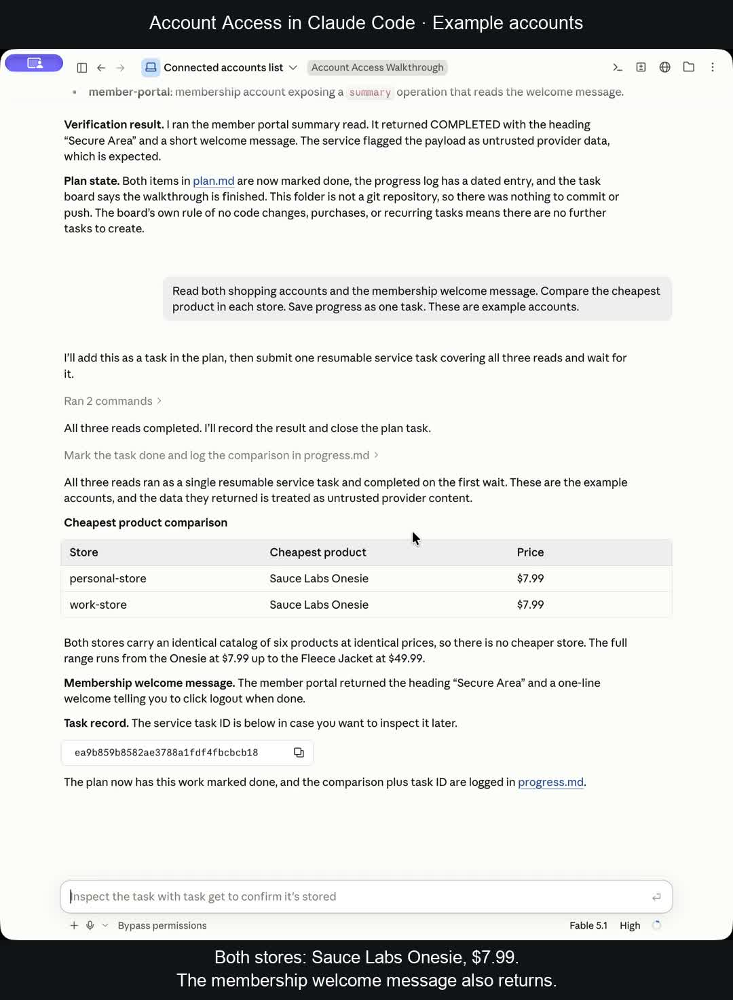

# Using Account Access in Claude Code

[Watch the real computer recording](https://github.com/fainir/account-access/releases/download/v0.4.0/account-access-claude-code-live.mp4) · [Captions](claude-live.vtt)

This video shows the actual Claude Code desktop interface using the installed Account Access skill. One request reads two shopping accounts and a membership account, compares the cheapest products, and saves progress as one task. The accounts are intentionally public examples on SauceDemo and The Internet; the reads and responses are real.

To try it yourself:

1. [Download the Mac installer](https://github.com/fainir/account-access/releases/download/v0.4.0/Account-Access-Installer.zip), unzip it, and open **Install Account Access.command**. If macOS blocks the unsigned launcher, follow the [one-command alternative](../../README.md#easy-installation).
2. In setup, choose **Claude Code**, **Codex**, or both. Connect supported accounts and approve their listed reads. [The public example usernames and passwords are in the main guide](../../README.md#connect-and-use).
3. Open a fresh Claude Code session and send:

   > /account-access Read both shopping accounts and the membership welcome message. Compare the cheapest product in each store. Save progress as one task.

In Codex, use `$account-access` instead of `/account-access`.

The video begins after account connection. Full installation/browser setup footage and footage of the Codex interface are unfinished: the computer tool rejected access to the browser setup URL. A recording of those steps is still required to complete the requested installation-and-use walkthrough. The [older edited overview](legacy-guide.md) uses slides and an earlier manual setup.

On October 13, 2026, both the actual Claude Code desktop interface and Codex CLI completed three supported reads in one task. Independently inspected service results showed the Sauce Labs Onesie at **$7.99** in both stores, and the membership welcome message. [Verification metadata](../../artifacts/video/live-recording.json) identifies the tasks without credentials or private account data.

The footage contains no generated app screens. Editing removes window-capture padding, shortens one wait, and adds narration and captions. The final screen stays visible briefly for reading. To reproduce the edit on macOS, install Pillow and ffmpeg, generate narration with `say`, and run `scripts/make_live_recording.py` with the original window capture and narration file. Original captures and raw agent logs are local, Git-ignored files.
