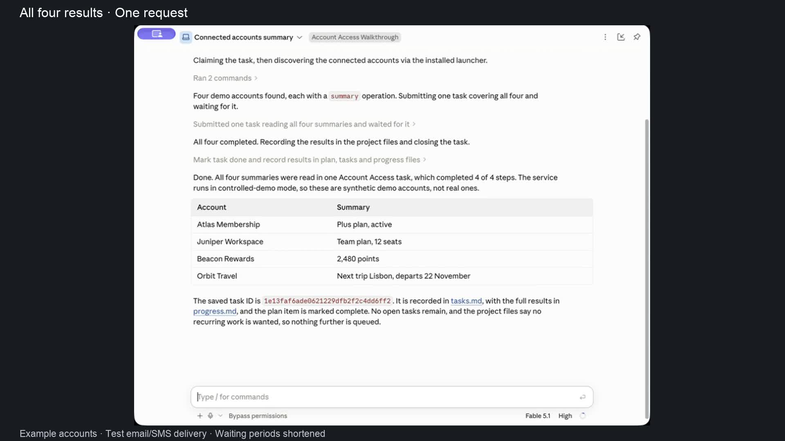

# Download, install and use Account Access

[Watch the 75-second computer walkthrough](https://github.com/fainir/account-access/releases/download/v0.6.0/account-access-quickstart.mp4) · [Captions](quickstart.vtt) · [Recording evidence](../../artifacts/video/quickstart.json)

[](https://github.com/fainir/account-access/releases/download/v0.6.0/account-access-quickstart.mp4)

The recording follows one short sequence:

| Time | Action |
| --- | --- |
| 0:00 | Download the Mac app from the public GitHub release and open it |
| 0:07 | Click Install; existing AI tools connect automatically |
| 0:13 | Choose a Chrome-compatible password export and approve four account reads |
| 0:22 | Save the configured email connection locally |
| 0:28 | Review SMS forwarding/Mac access and save the SMS source |
| 0:34 | Import an authenticator setup QR and save its masked key |
| 0:40 | Ask Claude Code in ordinary language, without a command or skill name |
| 0:48 | Watch password, authenticator, email and SMS website sign-ins |
| 1:09 | Read Claude's four completed results |

All application and website pixels are actual recordings: Chrome, Finder, the native 0.6 app, Claude Code and browser form submissions performed by Account Access. The edit adds narration and captions, crops windows, removes waits and slows the short website login clips. It contains no slides or generated application screens. Setup includes repeated recorded takes; it is not one uninterrupted installation session.

The prompt was **“Summarize my four connected accounts and save the results as one task. Keep it short.”** Claude automatically discovered the skill and permitted operations, submitted a task and returned **4/4 completed**. Task `1e13faf6ade0621229dfb2f2c4dd6ff2` was independently inspected through the installed client. The four login clips were recorded after the example sessions expired, during this task. No password, code or further owner action was entered after the request. Claude's existing host approval settings were retained.

Atlas Membership, Juniper Workspace, Beacon Rewards and Orbit Travel are fictional accounts on four distinct local website origins. The password file is a synthetic Chrome-format CSV, not an export of the user's private vault. The native file pickers show only the recording's password file and setup QR. Email uses actual TLS IMAP with synthetic messages; SMS uses a Messages-format test database, without carrier delivery or a physical phone. SMS forwarding and broad Mac privacy permission are explained in the app; that OS permission was not granted for the recording. The authenticator uses explicit QR enrollment and actual locally generated TOTP. These sources do not establish private Gmail, iPhone or arbitrary website coverage.

The public 0.6 archive was downloaded and checksum-verified. The configured recording copy uses a separate app identity, vault and installation paths, plus a private copy of the existing browser dependency cache. Its install action runs the published checksum-verified bootstrap and wheel. The normal app, agent launcher metadata, token and standing grants were restored and checked after filming. The preview is Developer ID signed; Apple notarization is pending, so the recording does not demonstrate a clean-Mac notarized download opening.

Importing a password does not add an unsupported website connector. Available accounts and reads still require reviewed configuration and owner grants. Genuine passkey, biometric, device, push or administrator approval remains an owner action.

To reproduce the edit on macOS with ffmpeg, Pillow and these private source recordings:

```sh
python scripts/make_quickstart_video.py \
  --work /path/to/recordings \
  --output /path/to/account-access-quickstart.mp4
```

Older recordings: [0.5 installation and verification](https://github.com/fainir/account-access/releases/download/v0.5.0/account-access-install-import-and-verify.mp4), [0.4 three-account walkthrough](https://github.com/fainir/account-access/releases/download/v0.4.1/account-access-install-and-use.mp4), and [legacy overview](legacy-guide.md).
