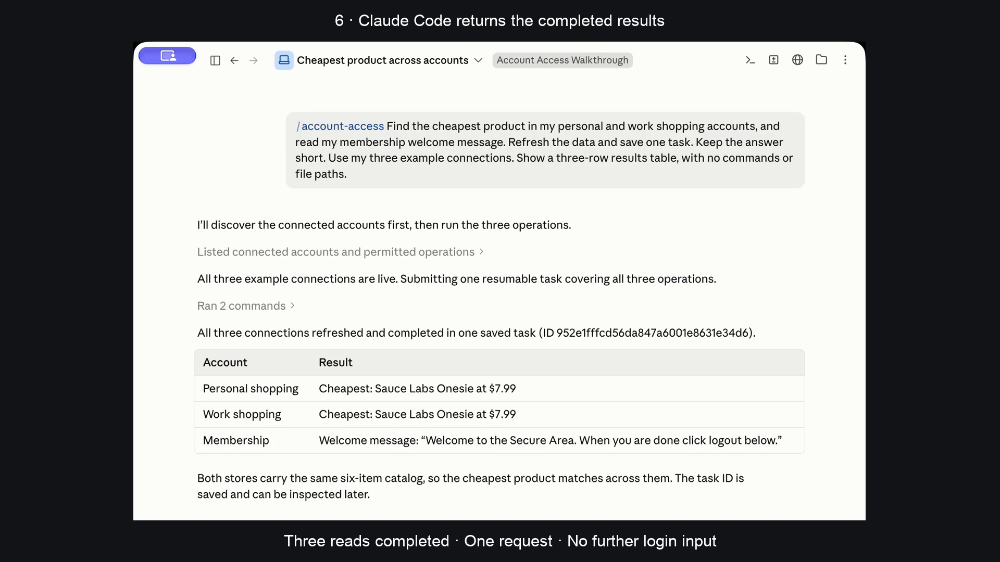

# Install Account Access and use Claude Code

[Watch the computer walkthrough](https://github.com/fainir/account-access/releases/download/v0.4.1/account-access-install-and-use.mp4) · [Captions](install-and-use.vtt)

[](https://github.com/fainir/account-access/releases/download/v0.4.1/account-access-install-and-use.mp4)

The video shows actual Finder, the native graphical installer and setup app, Claude Code, and Account Access’s real browser activity. It follows installation, choosing both AI tools, entering three account logins once, approving specific reads, sending one Claude request, three automatic sign-ins, and the completed results. No application or website screens were generated.

The graphical build is a Developer ID signed [Mac preview](../../macos/README.md). It works on the recording Mac; public notarization remains pending because the configured Xcode account could not authenticate. Gatekeeper can block the [preview download](https://github.com/fainir/account-access/releases/download/v0.4.1/Account-Access-Mac-preview.zip). The [legacy installation instructions](../../README.md#easy-installation) remain available. This recording does not demonstrate opening a newly downloaded notarized package on a clean Mac.

To follow the recorded setup:

1. Open the graphical Account Access app and click **Install Account Access**.
2. Select **Claude Code**, **Codex**, or both, then click **Set up my AI tools**. Have the selected AI tool installed and signed in already.
3. Connect a supported account using its username/email and password, approve the listed read, and click **Connect account**. Repeat for other supported accounts.
4. Copy the request and open a fresh Claude Code chat. Ask for the account work using `/account-access`; in Codex use `$account-access`.

The three connections use intentionally public identities on SauceDemo and The Internet. The [public usernames and passwords](../../README.md#connect-and-use) let you try the flow without a private account. The two shopping accounts share the same six-product catalog; the cheapest item in both is the Sauce Labs Onesie at **$7.99**. The third connection returns the membership welcome message.

For filming, the three saved example sessions were expired before the Claude task. The credentials and approved permissions stayed in the encrypted vault. One request completed all three operations; independent audit inspection confirmed three password-recovery events and zero user login inputs during that task. A subsequent task through the installed Codex skill completed the same reads using the saved access. [Verification metadata](../../artifacts/video/install-and-use.json) records the task IDs, source release, media hashes, and limits.

Claude used its existing tool-approval configuration. The app did not configure the AI host’s approval mode. Tests here establish the named example reads, not general private-account access or universal unattended authentication.

The native app installs the published checksum-verified 0.4.1 wheel into a fresh vault; dependency downloads were already cached. Editing shortens waits, crops window padding, slows real login footage, and adds offline narration and captions. Every app/page image comes from recorded footage. The last result stays visible for reading. Raw footage and agent traces remain private, Git-ignored files.

Reproduce the edit on macOS with Pillow, ffmpeg, the original captures, and their manifest/proof files:

```sh
python scripts/make_full_walkthrough.py --work /path/to/captures --output /path/to/walkthrough.mp4
```

The [earlier Claude-only recording](https://github.com/fainir/account-access/releases/download/v0.4.0/account-access-claude-code-live.mp4) starts after connection. The [legacy overview](legacy-guide.md) uses slides and earlier manual setup.
